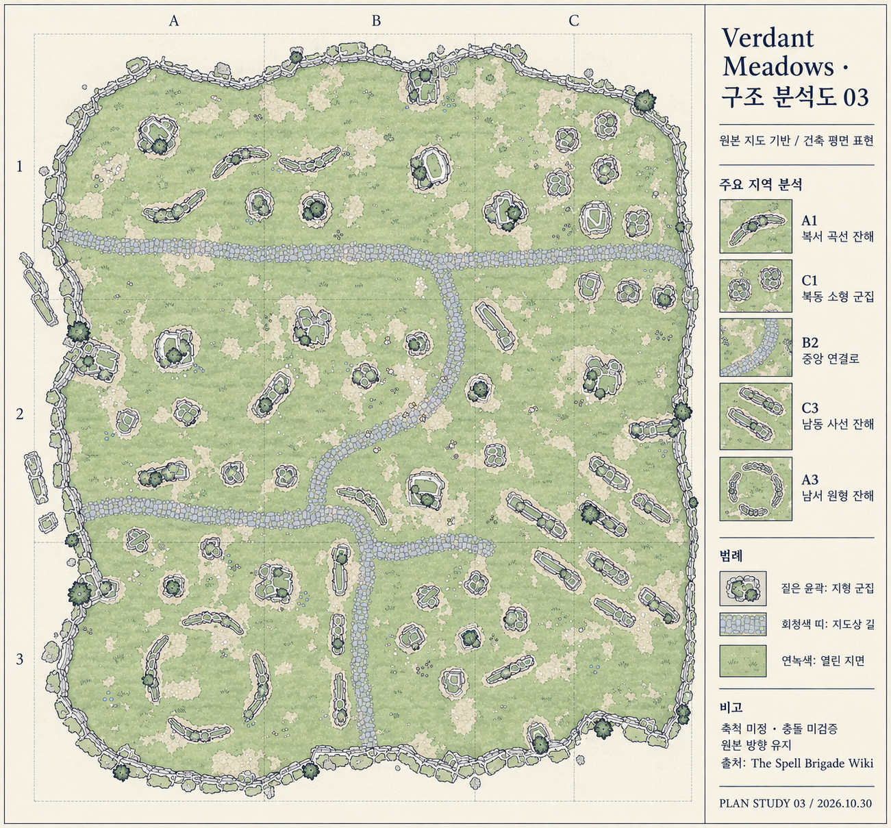

# Verdant Meadows 구조 분석과 평면도 03

2026-10-30 KST. 원본 기반 공간 분석 및 건축 평면 표현. 게임 구현·최종 맵 채택·정밀 실측 완료가 아니다.

## 요청과 범위

| 근거 구분 | 내용 |
|---|---|
| 사용자 요구 | 재발 방지 기준 문서화, Verdant Meadows 원본 이미지 직접 참조, 구조 분석 후 건축설계도 느낌으로 재작성 |
| 유지 | 불규칙한 외곽, 전역에 분산된 지형 군집, 지역별 형태 차이, 원본 길 연결, 열린 공간의 분포 |
| 변경 | 어두운 게임 렌더를 밝은 종이·선화·해칭·범례로 표현 |
| 에이전트 제안 | A~C/1~3 분석 격자와 다섯 지역 해설. 실제 게임 구역이나 좌표 체계가 아님 |
| 미정 | 실제 크기, 충돌, 높이, 파티 점유, 길 밖 이동, 스폰, 공격 차단, 우리 게임에 적용할 최종 배치 |

이전 01·02안의 중앙 공터, 100×80 U, 장애물 5개, 고정 중앙 시작점은 이번 원본 분석의 조건으로 사용하지 않았다. 이번 결과는 원본의 구조를 이해하는 분석도이며 우리 게임의 독자적인 최종 설계 확정을 뜻하지 않는다.

## 원본과 입력 증거

- [사용자가 지정한 페이지](https://thespellbrigade.wiki.gg/wiki/Verdant_Meadows).
- [원본 파일 설명](https://thespellbrigade.wiki.gg/wiki/File:VerdantMeadowsFullMap.png): Top view of the Verdant Meadows, 1195×1110 PNG. 파일 이력에는 FetFlygandeKatt, 2025-01-03 등록으로 표시된다.
- [원본 이미지 URL](https://thespellbrigade.wiki.gg/images/VerdantMeadowsFullMap.png?2e778b&format=original).
- [로컬 참조 원본](../art/maps/references/VerdantMeadowsFullMap.png). 브라우저에서 Original file 다운로드 후 프로젝트에 복사하고 픽셀을 직접 확인했다. 원본은 수정하지 않았다.
- 내장 image_gen 입력의 referenced_image_paths에 위 로컬 원본 한 장을 실제 전달했다. 01·02 이미지는 입력하지 않았다. [실제 생성 프롬프트](../art/maps/verdant-meadows-plan-03-prompt.txt).

## 원본에서 관찰한 구조

방향 표현은 이미지 위·아래·좌·우를 기준으로 한다. 실제 게임 방위는 확인하지 않았다. 지형 군집은 돌·식생이 함께 보이는 시각적 묶음으로, 충돌체와 동일하다는 뜻이 아니다.

| 항목 | 원본에서 보이는 사실 | 설계상 해석·한계 |
|---|---|---|
| 외곽 | 돌처럼 보이는 경계가 굴곡을 이루며 둘러싸고, 좌우와 아래쪽에 돌출·들어간 부분이 있음 | 매끈한 직사각형으로 정리하면 지역별 차이를 잃음. 정확한 충돌 경계는 미확인 |
| 전체 분포 | 여러 크기의 독립 군집이 지도 전반에 수십 개 분산 | 중앙 몇 개만 놓는 시안과 밀도 구조가 다름. 정확한 군집 수는 미집계 |
| 위쪽 가로 길 | 상부 약 1/3 높이에서 좌우를 잇는 돌바닥 띠 | 지도의 큰 기준선. 띠 밖 이동 가능 여부는 이미지로 확정하지 않음 |
| 중앙 연결 | 위 가로 길 중간보다 오른쪽에서 내려온 길이 왼쪽으로 굽어 하부 길과 이어짐 | 직선 십자로나 외곽 원형 도로로 바꾸면 연결 형태가 달라짐 |
| 하부 연결 | 아래쪽 가로 흐름과 아래 경계 쪽으로 이어지는 세로 흐름 | 원본 길의 분기 관계를 보존할 필요 |
| A1 왼쪽 위 | 짧고 휘어진 길쭉한 군집과 독립된 둥근 군집 혼재 | 방향과 길이가 다른 소규모 차단선 후보. 실제 차단 여부는 미확인 |
| C1 오른쪽 위 | 작은 원형·다각형 군집이 비교적 모여 있음 | 지역별 군집 간격 변화가 있음 |
| B2 중앙 | 길 주변에 빈 바닥이 있으면서 중소형 군집도 분산 | 중앙 전체가 비워진 하나의 큰 공터가 아님 |
| C3 오른쪽 아래 | 비슷한 사선 방향의 길쭉한 잔해가 여러 줄로 반복 | 이 지역의 가장 뚜렷한 방향성 |
| A3 왼쪽 아래 | 곡선 잔해 여러 조각이 끊어진 원형을 이룸 | 닫힌 방으로 그리거나 원형 잔해를 생략하면 원본 특징 소실 |
| 지면 | 녹색 바닥에 불규칙한 밝은 흙 무늬가 분포 | 균일한 베이지 공터와 다른 인상. 지면색을 이동 규칙으로 해석하지 않음 |

## 결과

주요 구조를 선화로 재표현했다. 이미지의 A~C/1~3은 설명용 격자이고 원본의 공식 구획이 아니다. 범례의 ‘지형 군집’은 원본 시각 형태이며 통과 불가 판정을 확정하지 않는다.

## 원본 대비 검토

| 비교 항목 | 결과 | 근거와 잔여 차이 |
|---|---|---|
| 불규칙 외곽 | PASS | 굴곡과 돌 경계 유지. 선이 정리되면서 일부 굴곡·전체 비율이 변함 |
| 전역 분포와 형태 다양성 | PASS | 수십 개의 원형·길쭉한·곡선형 군집을 분산. 전수 개수·좌표 일치 검증은 안 함 |
| 위쪽 가로 길·굽은 중앙 연결·하부 분기 | PASS | 주요 연결 관계가 유지됨. 길 폭과 세부 곡률은 원본과 차이 |
| 북동 작은 군집·남동 사선 반복·남서 끊어진 원형 | PASS | 세 지역의 식별 가능한 배치 특징 유지 |
| 중앙 열린 공간 | PASS | 중앙을 거대한 빈 광장으로 만들지 않고 군집과 길이 함께 남음 |
| 건축 평면 표현 | PASS | 평면 선화·범례·구획 표시. 원본 게임의 어두운 조명 제거 |
| 세부 원본 일치 | NOT_RUN | 정밀 추적·픽셀 대응·객체별 전수 검증 아님. 원본 밖 조각과 작은 장식은 재해석됨 |
| 실제 게임 적합성 | NOT_RUN | 4인 진형·우회·충돌·스폰·공격·카메라·성능 미검증 |

PASS는 위에 명시한 정성적 구조 특징의 시각 확인에 한정한다. 전체 원본 재현 정확도 또는 구현 가능성 PASS가 아니다. 특히 오른쪽 확대 예시는 해설용 재그림으로 원본 크롭이 아니다.

## 다음 설계에 적용할 원칙

이 분석도에서 우리 게임의 설계로 넘어갈 때에는 원본 관찰과 변경 제안을 다시 분리한다. 장애물을 줄이거나 통로를 넓힐 필요가 생기면 해당 지역과 변경 이유를 표시하며, 자동으로 중앙 공터형으로 단순화하지 않는다. 카메라·파티 크기를 적용한 후 실제 치수·충돌·스폰을 별도 설계한다.

작업 규칙: [레퍼런스 기반 시각 설계](../workflows/reference-design.md). 검토: [03 검증 기록](../reviews/VerdantMeadows-03-20261030.md).

## L1 작업 브리핑

- 상태: 문서·이미지 작업 완료、독립 검토 지적 보완 중. 게임 구현 상태와 별개다.
- 규모: L1. 로컬 시각 설계 워크플로우 도입을 포함하므로 development.md의 문서·설정 워크플로우 도입 분류를 적용했다.
- 요구와 제외 범위: 재발 방지 기준, 실제 원본 입력, 구조 분석, 건축 평면 이미지. Unity·런타임·배포·최종 맵 확정 제외.
- 관련 기획 및 사용자 확정 사항: 위 요청과 범위 표 및 원본 출처 절을 따른다. 01·02 단순 공터 전제를 철회한다.
- 기존 코드와 데이터 소유처: 런타임 소유처 변경 없음. 설계 자료는 docs/design, 시각 자산은 docs/art/maps, 작업 절차는 docs/workflows가 관리한다.
- 변경 파일과 전후 동작: AGENTS.md와 development.md는 시각 설계 규칙으로 연결한다. reference-design.md는 원본 직접 확인·전달·비교 절차를 신설한다. 본 문서·원본·결과·프롬프트·review를 추가하고 README·현재상태·design/art 입구·기준안·01/02 문서에는 대체 상태를 표시한다. 이전에는 자체 공터 조건을 확인했으나 이후에는 원본과 사용자 요구를 비교한다.
- 재사용 후보와 신설 이유: 기존 개발 워크플로우·validator-client·local 검사를 재사용한다. 시각 레퍼런스 입력과 충실도 확인에 별도 규칙이 필요해 reference-design.md를 추가했다. 원본03 자료는 잘못된01/02를 덮어쓰지 않고 분리한다.
- 실패·취소·생사·전환 경계: 원본 확보 불가는 BLOCKED, 핵심 특징 누락은 FAIL, 실제 게임 검증 미실행은 NOT_RUN. 생사·전투 상태 전환은 코드 미변경으로 해당 없음. 중단 시 기존 시안 보존, 미완료 결과를 채택으로 표시하지 않는다.
- 데이터 호환성과 복구: 게임 데이터 형식 변경 없음. 기존01/02 파일 보존. 되돌릴 때 현재 링크와 상태 안내를 함께 수정하고 원본·생성·검토 이력을 보존한다. 자동 동기화·외부 서비스 연결 없음.
- 검증 계획과 실행: 원본과 결과 직접 열기 → 외곽·군집·길·지역 특성 비교 → view_image와 항목별 표. 로컬 검사 → 문서 링크·참조·소스 안정성 확인 → Tools/Verify/run.py local. 독립 검토 → 규칙·상태·근거 구분 확인 → validator-client 계약 서브에이전트. 실제 결과는 review에 기록한다.
- 미정 사항과 영향: 실제 치수·충돌·카메라·진형·스폰은 이미지 완료를 막지 않으나 제작 사양 확정에는 추가 검증이 필요하다.
- 검토와 해소: 독립 검토에서 구조 대응은 확인했고 L1 브리핑 항목 누락을 지적했다. 본 절로 요구·범위·실패·복구·검증 계획을 보완했다. 브리핑은 사후 보완임을 명시하며 사전 작성으로 소급하지 않는다.

후속 자료: [우리 맵 적용 설계 04](3D배경-우리맵-적용설계-04.md). 본 문서는 원본 분석으로 유지하며 04에서 새로 제안한 규칙을 원작 사실로 소급하지 않는다.
