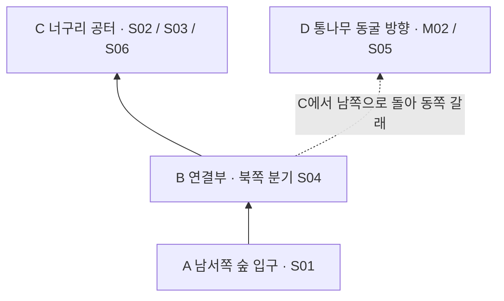

# 신비한 숲 3D 배경 분석 준비

작성일: 2026-10-30 KST. 상태: **레퍼런스 구역 선정 및 자료 대응 정리 완료, 제작 착수 전**.

꿈꾸는 섬 2019 Nintendo Switch판의 **남서쪽 숲 입구에서 너구리 공터까지**를 첫 분석 구역으로 선정한다. 동쪽 통나무 동굴 방향은 길의 분기를 읽는 보조 범위다. 지도와 실제 화면을 연결해 숲의 경계, 길, 열린 공간, 소품의 역할을 파악하는 것이 목적이다. 이 구역을 그대로 복제하거나 우리 게임의 완성 맵으로 확정하는 문서가 아니다.

실제 적용 범위와 요소별 검토 기준은 [꿈꾸는 섬에서 참고할 3D 배경 요소](3D배경-꿈꾸는섬-참고범위.md)를 따른다. 이 문서는 출처·관찰·자료 한계의 근거로 유지한다.

## 프로젝트에서의 위치

- 사용자 확정: 현재는 준비 단계이며 신비한 숲의 분석 구역과 지도·화면 자료를 정리한다.
- 배경 참고: 꿈꾸는 섬의 공간 구성과 시각 요소를 분석한다.
- 전투 방향: 사용자가 선택한 The Spell Brigade의 인상을 유지한다. 이번 문서는 그 게임의 맵 구조를 검증하지 않는다.
- 기존 [게임 컨셉](게임컨셉.md)의 2D 도트 방향에서 3D 배경을 검토하는 후속 준비다. 캐릭터를 2D로 유지할지, 3D로 바꿀지는 미정이다.
- 기존 1~4인 진형과 생존 전투는 [현재 상태](../현재상태.md), [할일](../../할일.md)을 기준으로 한다. 배경 검토가 기존 전투 규칙의 변경을 뜻하지 않는다.
- 작업 분류: L0 문서 작업. Unity 씬·코드·모델·재질과 실행 프로젝트는 변경하지 않았다.

## 분석 구역과 경계

분석 단위의 A~D 표기는 이 문서에서만 사용하는 식별자이며 게임의 공식 지명이나 좌표가 아니다.

| 구역 | 범위 | 분석 목적 | 포함 수준 |
|---|---|---|---|
| A 입구 | 남서쪽 마을 연결부에서 숲 안으로 들어오는 길 | 바깥 공간에서 숲으로 들어가는 시각적 전환 | 핵심 |
| B 연결부 | 입구에서 동쪽으로 돌아 북쪽 공터로 접근하는 구간 | 길의 굴곡과 나무 덩어리가 공간을 나누는 방식 | 핵심, 북쪽 분기 실제 화면 확보 |
| C 너구리 공터 | 단독 나무와 너구리가 있는 지점 주변 | 집중해서 볼 지점과 주변 식생의 관계 | 핵심 |
| D 동쪽 갈래 | C 남쪽에서 동쪽 통나무 동굴 입구 방향으로 이어지는 길 | 본선에서 옆길로 분기하는 구조 | 보조, 입구 외부 화면 확보 |

A→B→C를 주 분석 동선으로 둔다. C→남쪽 연결부→D는 별도 분기다. 숲 전체, 북쪽 열쇠 상자, 요정 구역, 버섯 획득 구역, 동굴 내부와 마녀 집은 이번 범위에서 제외한다. 지형 연결을 이해하는 데 필요한 부분만 주변 맥락으로 본다.

선정 이유는 입구와 공터의 실제 화면, 둘을 연결하는 지역 지도, 공터에서 동쪽으로 갈라지는 경로 지도가 같은 공략 안에 있기 때문이다. 광범위한 세계 지도보다 작은 범위에서 자료의 일치 여부를 검토하기 쉽다. 입구에서 공터까지의 모든 지점이 연속 사진으로 확보된 것은 아니다.

## 지도와 화면을 연결하는 읽기 순서

1. M00에서 광역 위치를 찾고, 더 상세한 M03을 원본 배율로 열어 숲의 연속된 길을 읽는다. M03은 지도 표현이며 실제 플레이 전경을 이어 붙인 이미지가 아니다.
2. M01에서 남서쪽 연결과 숲의 큰 덩어리를 읽는다. 노란 커서는 촬영 당시 플레이어 위치이며 입구 경계 자체를 뜻하지 않는다.
3. S01에서 입구의 외형을 확인한다. M01과 같은 순간·같은 카메라 위치의 화면이라고 가정하지 않는다.
4. M02의 단독 나무와 꺾이는 경로를 기준으로 C와 D의 관계를 찾는다.
5. S04로 B의 북쪽 분기를 확인하고, S05의 동굴 입구를 M02의 화살표 도착점과 대조한다. S04와 S05가 바로 맞닿는 연속 프레임이라는 뜻은 아니다.
6. S02와 S06으로 C의 실제 외형을 확인한다. S03은 같은 사건 구역의 보조 화면이지만 인물·촬영 위치가 달라 정밀 겹침 비교에 사용하지 않는다.

위 그림은 연결 관계만 보여주는 자체 도식이다. 실제 축척, 방위각, 길의 곡률, 장애물 좌표를 표현하지 않는다. B는 연속된 길을 묶은 분석 단위이므로 하나의 정확한 교차점으로 해석하지 않는다.

## 자료 목록

확인일은 모두 2026-10-30이다. 외부 이미지는 원본 링크로 연결하며 로컬에 복제하지 않았다. 자료 사이트가 바뀌면 링크가 끊길 수 있으므로 페이지 제목·본문 소제목·식별물을 함께 기록한다. 이미지의 게임 화면은 Nintendo 작품이며, 공략의 편집 표시는 해당 작성자의 자료다. 이 목록은 제작에 재사용할 에셋 목록이 아니다.

| ID | 자료와 직접 링크 | 종류와 확인 수준 | 사용 목적 |
|---|---|---|---|
| M00 | [Zelda’s Palace 지도 목록](https://www.zeldaspalace.com/linksawakening/maps.php) → [Switch 전체 지도](https://www.zeldaspalace.com/images/la/maps/cocolint_switch.jpg) | 916×513 원본 이미지 직접 시각 확인. 소품 상세 분석에는 낮은 해상도 | 광역 위치 안내만 |
| M03 | [Switch 월드 지도 원본](https://www.spriters-resource.com/media/assets/120/122835.png?updated=1755479425) · [게시 페이지](https://www.spriters-resource.com/nintendo_switch/thelegendofzeldalinksawakening/asset/122835/) | 2800×1600 이미지 직접 시각 확인. 원본 배율에서 신비한 숲 확인 | 연속된 길·나무 덩어리 배치의 보강 기준 |
| M01 | [신비한 숲 지역 지도](https://vgkami.com/wp-content/uploads/2022/02/map-view-of-the-mysterious-forest-1024x576.jpg) | 실제 지도 메뉴 캡처, 1024×576, 직접 시각 확인 | A~C의 지역 맥락 |
| M02 | [통나무 동굴 방향 표시 지도](https://vgkami.com/wp-content/uploads/2022/02/path-to-central-log-cave-1024x576.jpg) | 지도 메뉴 위 빨간 화살표, 1024×576, 직접 시각 확인 | C→D 연결 |
| S01 | [숲 진입 화면](https://vgkami.com/wp-content/uploads/2022/02/featured-image-the-legend-of-zelda-links-awakening-make-your-way-through-the-mysterious-forest.jpg) | 게임 화면, 직접 시각 확인 | A의 외형 |
| S02 | [너구리 대화 화면](https://vgkami.com/wp-content/uploads/2022/02/mysterious-forest-raccoon-1024x576.jpg) | 게임 화면, 1024×576, 직접 시각 확인 | C의 외형 |
| S03 | [타린으로 돌아온 뒤의 화면](https://vgkami.com/wp-content/uploads/2022/02/Tarin-in-the-mysterious-forest-1024x576.jpg) | 게임 화면, 1024×576, 직접 시각 확인 | C 주변의 보조 관찰 |
| S04 | [북쪽 공터로 꺾이는 연결부](https://zeldauniverse.net/wp-content/uploads/2019/09/guide-la-switch-01-north-path-to-raccoon.jpg) | 게임 화면, 886×498, 직접 시각 확인 | B 북쪽 분기 |
| S05 | [통나무 동굴 외부](https://zeldauniverse.net/wp-content/uploads/2019/09/guide-la-switch-01-forest-log-cave-886x498.jpg) | 게임 화면, 886×498, 직접 시각 확인 | D 외부 전경 |
| S06 | [너구리 공터의 다른 시점](https://zeldauniverse.net/wp-content/uploads/2019/09/guide-la-switch-01-forest-raccoon-886x498.jpg) | 게임 화면, 886×498, 직접 시각 확인 | C의 구역 대응 보강 |
| P02 | [Zelda Universe 신비한 숲 공략](https://zeldauniverse.net/guides/links-awakening/walkthrough/mysterious-forest/) | Joshua Lindquist, 2019-09-19. 본문과 직접 연결 이미지 확인 | S04~S06 출처 및 경로 교차 확인 |
| P01 | [VGKAMI 신비한 숲 공략](https://vgkami.com/walkthrough/links-awakening/the-mysterious-forest/) | 글·이미지·브라우저 확인. 게시일 2022-02-04 | M01~S03의 출처 및 이동 설명 |

P01의 작성자는 Reyadh Rahaman, 검토자는 Marshall Gunnell이다. 게시일을 현재 게임의 패치 버전으로 해석하지 않는다. 이미지가 Switch판의 3D 표현임은 보이지만 정확한 소프트웨어 버전은 미확인이다. 자료가 여러 장이어도 M01~S03은 같은 공략 출처이므로 독립된 여러 출처의 검증으로 세지 않는다.

P02는 P01과 별도 출처다. S04~S06은 P02 한 출처의 이미지이므로 서로 독립된 세 번의 검증으로 세지 않는다. P02 본문에는 Game Boy 전용 설명도 있지만, 채택 이미지는 직접 시각 확인한 Switch판 3D 화면으로 한정했다.

## 대표 자료 미리보기

원본 서버에서 불러오는 이미지다. 표시되지 않으면 자료 목록의 직접 링크를 연다. 아래 지도와 화면은 같은 축척이 아니다.

M02 — 빨간 표시가 있는 경로 지도. 출처: P01 VGKAMI.

S01 — A 입구. 출처: P01 VGKAMI.

S02 — C 공터. 출처: P01 VGKAMI.

### 추가 확보한 연결부와 동굴 외부

S04 — B 북쪽 분기. 동서 길과 남북 길이 만나는 부분. 출처: P02 Zelda Universe.

S05 — D 외부. 통나무 입구와 표지판을 식별할 수 있다. 출처: P02 Zelda Universe.

S06은 자료 목록의 링크로 열어 S02와 비교한다. 같은 공터를 서로 다른 인물 위치에서 보여주며 하단은 대화창에 가려져 있다.

## 위치 대응표

M02의 이미지 좌측 상단을 (0,0), 우측 하단을 (1,1)로 보았을 때의 **대략적인 탐색 범위**다. 게임 좌표가 아니며, 원본을 열어 해당 부분을 찾는 용도로만 사용한다. 범위는 눈으로 판독한 값이고 실측이 아니다.

| 구역 | M02에서 찾는 위치와 식별물 | 실제 화면 | 대응 판단과 한계 |
|---|---|---|---|
| A | 왼쪽 아래 숲과 마을이 연결되는 목 부분. 대략 x 0.20~0.30, y 0.57~0.72 | S01 | 지역명과 P01의 진입 설명으로 대응. 정확한 촬영 발 위치는 미확정 |
| B | A 위에서 중앙 방향으로 돌아 C 아래로 이어지는 열린 바닥. 대략 x 0.22~0.39, y 0.40~0.62 | S04 | 북쪽 분기와 동서 방향 길을 확인. A에서 이 지점까지의 모든 구간은 미확보 |
| C | M02 빨간 화살표의 출발점 위쪽 단독 나무 주변. 대략 x 0.32~0.38, y 0.28~0.42 | S02, S03, S06 | P01과 P02의 너구리/타린 설명으로 구역 대응. 인물 위치와 카메라 차이 때문에 두 화면의 나무를 일대일로 대응시키지는 않음 |
| D | 빨간 화살표 끝과 노란 커서 주변. 대략 x 0.47~0.53, y 0.44~0.55 | S05 | 통나무 출입구와 왼쪽 표지판을 확인. P02의 동쪽 이동 설명 및 M02의 종점으로 구역 대응 |

M01과 M02는 화면 속 지도 위치가 다르다. 같은 픽셀 위치를 같은 지점으로 간주하지 않고 단독 나무·통로·마을 건물 같은 식별물로 대조한다. M02의 빨간 선은 공략 작성자의 이동 표시이지 게임 내 길의 폭이나 정확한 중심선이 아니다.

## 직접 확인한 화면과 분석 질문

아래 링크를 열면 원본 화면을 볼 수 있다. 관찰은 화면에 보이는 범위에 한정한다.

### A 입구

[지도 M01](https://vgkami.com/wp-content/uploads/2022/02/map-view-of-the-mysterious-forest-1024x576.jpg) · [실제 화면 S01](https://vgkami.com/wp-content/uploads/2022/02/featured-image-the-legend-of-zelda-links-awakening-make-your-way-through-the-mysterious-forest.jpg)

**관찰:** 양옆 수관이 겹치며 길을 감싸고, 가운데 바닥은 비교적 비어 있다. 상단에는 풀 덩어리가 있고 가장자리에는 푸른 흐림이 보인다.

**분석 질문:** 숲의 밀도는 길 옆에서 만들고 이동 중앙은 비우는 구성을 우리 화면에서도 사용할 수 있는가? 화면 가장자리의 흐림은 전투 시 적 발견을 방해하지 않는가?

**해석 제한:** 흐림이 안개, 피사계 심도, 다른 화면 효과 중 무엇인지 확정하지 않는다. 진입 연출 화면의 시점을 평상시 카메라 설정으로 채택하지 않는다.

### B 연결부

[지도 M01](https://vgkami.com/wp-content/uploads/2022/02/map-view-of-the-mysterious-forest-1024x576.jpg) · [분기 지도 M02](https://vgkami.com/wp-content/uploads/2022/02/path-to-central-log-cave-1024x576.jpg)

**분석 질문:** 나무를 개별 장식으로 흩뿌리는 대신 덩어리로 묶었을 때 길과 공터의 경계가 명확해지는가? 이동 공간을 넓혀도 숲의 인상이 유지되는가?

[실제 화면 S04](https://zeldauniverse.net/wp-content/uploads/2019/09/guide-la-switch-01-north-path-to-raccoon.jpg) · [대응 설명 P02](https://zeldauniverse.net/guides/links-awakening/walkthrough/mysterious-forest/)

**추가 관찰:** S04에서 화면 중앙 오른쪽의 나무 덩어리 아래로 동서 방향 흙길이 지나고, 왼쪽의 남북 방향 길과 만난다. 길 가장자리에 푸른 꽃, 낮은 식물, 뿌리 형태가 보인다. 두 길의 화면상 폭이 다르지만 이를 월드 단위의 폭 차이로 단정하지 않는다.

**위치 근거:** P02는 첫 동굴에서 서쪽으로 돌아 북쪽으로 꺾는 설명에 이 화면을 배치한다. M02의 빨간 경로가 C에서 남쪽으로 내려온 뒤 동쪽으로 꺾이는 모양과 대응한다. 따라서 S04는 B 전체의 대표가 아니라 **B의 북쪽 분기와 D로 향하는 갈래를 보여주는 화면**으로 채택한다. 화면의 적 위치는 고정 지형 식별물로 쓰지 않는다.

**남은 공백:** A에서 S04 지점까지 이어지는 남서쪽 굴곡의 연속 화면, 가려진 바닥, 정확한 길 폭·충돌 경계는 미확인이다. S04 바깥을 임의로 이어 붙여 완전한 파노라마 지도로 만들지 않는다.

### C 너구리 공터

[경로 지도 M02](https://vgkami.com/wp-content/uploads/2022/02/path-to-central-log-cave-1024x576.jpg) · [대화 화면 S02](https://vgkami.com/wp-content/uploads/2022/02/mysterious-forest-raccoon-1024x576.jpg) · [사건 이후 S03](https://vgkami.com/wp-content/uploads/2022/02/Tarin-in-the-mysterious-forest-1024x576.jpg)

**관찰:** S02는 단독 나무, 낮은 식물, 긴 풀, 꽃과 인물을 함께 보여준다. S03에서는 길 양옆 식생과 흙바닥이 보인다. 두 화면 모두 대화창이 아래쪽을 가린다.

**분석 질문:** 큰 나무 하나를 시선을 모으는 요소로 쓰면서도 파티의 실루엣이 잘 보이게 할 수 있는가? 낮은 식물과 긴 풀을 어디까지 이동 공간에 둘 것인가?

**해석 제한:** 공터라는 이름이 대규모 전투에 충분한 면적이라는 뜻은 아니다. 대화창 뒤의 바닥과 물체는 추정해 채우지 않는다. 사건 전후 캐릭터 변화와 지형 변화도 혼동하지 않는다.

### D 보조 분기

[동쪽 동굴 방향 M02](https://vgkami.com/wp-content/uploads/2022/02/path-to-central-log-cave-1024x576.jpg)

[외부 실제 화면 S05](https://zeldauniverse.net/wp-content/uploads/2019/09/guide-la-switch-01-forest-log-cave-886x498.jpg)에서 출입구, 왼쪽 표지판, 앞쪽의 열린 바닥을 확인했다. P02의 동쪽 이동 안내와 M02 종점을 연결해 D의 외부 모습을 보강한다. 북쪽의 바위로 막힌 다른 동굴과 구분한다.

이 자료는 외부 식별물과 공간 경계 분석용이다. 우리 게임에 동굴이나 실내 전환을 추가하기로 결정한 것은 아니다.

## 우리 게임을 위한 소품 조사표

다음은 자체 제작 후보를 분류한 목록이다. 원작 에셋의 정확한 종류 수·폴리곤 수·프리팹 구조를 뜻하지 않는다. 수량, 제작 도구, 조달 방법은 미정이다.

| 요소 | 먼저 정할 역할 | 확인할 제작 기준 | 참고 자료 |
|---|---|---|---|
| 기본 바닥 | 캐릭터와 공격 효과를 읽는 배경 | 명도, 무늬의 크기, 반복감 | S01~S05 |
| 흙길 경계 | 이동 가능 공간의 방향 안내 | 풀과의 경계가 지나치게 복잡하지 않은지 | S01, S03, S04 |
| 큰 수관과 줄기 | 숲 외곽과 공간 분할 | 겹침, 발밑 가림, 화면에 차지하는 면적 | S01, S02 |
| 낮은 관목 | 큰 나무와 바닥 사이의 시각적 연결 | 캐릭터 발과 공격 표시를 덮는 정도 | S02 |
| 긴 풀 | 특정 구역의 밀도와 질감 | 장식인지 이동에 영향을 줄지 | S02, S03 |
| 꽃·낙엽·작은 돌 | 작은 색 변화와 바닥 장식 | 적·전리품으로 오인하지 않는 대비 | S02, S03 |
| 단차와 경계면 | 통과 불가능한 공간의 시각적 안내 후보 | 실제 충돌과 시각 경계를 일치시킬지 | 화면 관찰만으로 충돌 확정 불가 |
| 통나무·표지판 | 갈림길의 식별물 후보 | 입구 형태와 표지판의 식별력 검토, 도입 여부는 후순위 | S05 및 P02 |

## 적용 원칙과 미정 사항

현재 채택하는 것은 **관찰과 정리 방법**이다. 다음 표의 구현 방향은 제안이며 확정 사양이 아니다.

| 항목 | 제안 | 결정에 필요한 근거 |
|---|---|---|
| 파티 공간 | 원작의 통로를 복제하지 않고 4인 진형에 맞춰 여유 확보 | 현재 세 진형의 점유 범위와 적 회피 공간 |
| 숲의 인상 | 큰 식생은 경계에 모으고 중앙의 작은 장식은 제한 | 대표 화면에서 인물·적·공격 표시의 구분 |
| 단독 나무 | 핵심 전투 영역 밖의 기준점부터 시험 | 나무 뒤 가림과 우회 상황 |
| 지도 범위 | 고정 소구역, 반복 구역, 무한 확장 중 선택 필요 | 기존 무한 평면 전투와의 접점 검토 |
| 충돌 | 장식과 이동 차단물을 명시적으로 구분 | 파티·적의 경로 처리 설계 |
| 카메라 | 고정 시점 후보를 비교하되 수치는 실험에서 결정 | 실제 캐릭터와 UI가 있는 화면 |
| 캐릭터 | 2D 유지와 3D 전환은 별도 결정 | 배경과의 접지감, 애니메이션 제작 범위 |
| 안개와 흐림 | 첫 검증에서는 약하게 적용하거나 제외하는 후보 | 가장자리 적·투사체 인지 여부 |

지금 수치화하지 않을 것: 카메라 각도와 렌즈, 월드 단위의 나무 높이, 정확한 통로 폭, 원작 조명·재질 값, 나무별 충돌체. 화면상의 비율을 측정하더라도 깊이 차이와 가림의 영향을 명시해야 한다.

## 자료 충족도와 후속 준비

| 질문 | 현재 판정 | 다음 준비 |
|---|---|---|
| 분석할 구역이 명확한가 | 충족 | A~C를 유지하고 D는 보조로 관리 |
| 지도와 실제 화면을 연결할 수 있는가 | A·C 및 B 북쪽 분기·D 외부를 구역 단위로 대응 | 정확한 촬영 좌표나 연속 파노라마로 해석하지 않음 |
| 연결부의 상세 외형까지 아는가 | 부분 충족 | S04로 북쪽 분기 보강. A~S04 남서쪽 굴곡은 남은 공백 |
| D 외부의 소품 형태를 알 수 있는가 | 보이는 범위 충족 | S05의 통나무·표지판·입구 앞 공간. 뒤쪽과 내부는 제외 |
| 영상 없이 준비를 진행할 수 있는가 | 가능 | 지도·정지 이미지 중심의 자료 정리 지속 |
| 영상 없이 원작을 정확히 재현할 수 있는가 | 이 자료로는 불가 | 재현을 완료 기준으로 삼지 않음 |
| 우리 게임의 첫 맵 제작 사양인가 | 아님 | 캐릭터·충돌·카메라·맵 경계 결정 후 별도 설계 |

다음 작업의 우선순위는 A·B 북쪽 분기·C에서 참고할 형태 선택 → 우리 전투 공간 조건 정리다. 남서쪽 굴곡까지 원작의 배치를 분석하려는 경우에만 추가 정지 이미지가 필요하다. 현재의 준비 범위는 해당 공백을 명시한 상태로 진행 가능하며, 그 공간을 자체 설계할 때에는 원작에서 확인한 배치와 구분한다.

## 2026년 10월 30일 자료 보강

기존의 B 전용 화면 부재는 S04 확보로 부분 해소됐고, D 외부 전경 부재는 S05로 해소됐다. S06은 C의 단독 나무·관목·긴 풀 조합을 별도 출처에서 확인하는 보조 자료다. 추가로 열어 본 Zelda Dungeon의 Tail Cave 공략은 403으로 본문 확인이 되지 않아 신규 화면 근거에서 제외했다. 영상은 열거나 분석하지 않았다.

## 레퍼런스 적합성 재평가

2026-10-30 후속 조사. **꿈꾸는 섬은 배경 미술과 공간 구성의 보조 레퍼런스로 유지하되, 우리 생존 전투 맵의 단독 기준으로 채택하는 것은 추천하지 않는다.** 이는 에이전트의 재평가이며 사용자 최종 선택을 대신하지 않는다.

### 추가 조사 결과

| 조사 경로 | 실제 확인 결과 | 평가에 주는 영향 |
|---|---|---|
| 기존 Switch 전체 지도 M00 | 916×513 이미지 직접 열람 | 기존에 전체 지도라는 이유만으로 상세 분석 가능성을 높게 평가한 것은 정정 |
| M03 월드 지도 | 2800×1600. 브라우저의 원본 배율에서 숲의 남서쪽 굴곡, 나무 덩어리, 공터와 동쪽 분기를 연속 확인 | 길의 연결과 큰 배치를 영상 없이 분석할 근거는 확보 |
| [Link’s Hideaway 워프 지도](https://www.linkshideaway.com/assets/linkshideaway.com/images/guides/links-awakening-switch/warp-points/warp-portal_map.jpg) | 900×502, 지도 위 워프 표시 | 상세 배치 추가 근거로는 가치가 낮음 |
| [Zelda Maps](https://zeldamaps.com/?game=LA) | 브라우저에서 Link’s Awakening 제목과 마커 표시. 확인 당시 배경 타일은 검게 표시 | 세부 지형 확인 성공으로 세지 않음. 사이트 전체가 고장났다고 단정하지 않음 |
| [Spriters Resource 게시 페이지](https://www.spriters-resource.com/nintendo_switch/thelegendofzeldalinksawakening/asset/122835/) | 페이지는 보안 확인 화면. 별도로 이미지 검색에 공개된 M03 직접 URL은 정상 표시 | 이미지 자체의 판독과 게시 페이지 전체 검증을 구분 |
| [Models Resource의 Map 항목](https://models.spriters-resource.com/nintendo_switch/thelegendofzeldalinksawakening/asset/319917/) | 본문 403, 검색 요약만 확인 | 숲 전체의 3D 장면이라고 확인하지 못했으므로 근거 제외 |
| [DX 전체 지도](https://www.linkshideaway.com/links-awakening/overworld-map/) 및 [팬 3D 변환](https://github.com/sp00nznet/la3d) | 각각 DX판 지도, DX 기반 복셀 변환으로 명시 | Switch판 실제 지형·재질 근거에서 제외 |
| [Nintendo 공식 아트북 안내](https://www.nintendo.com/jp/switch/ar3na/products/soft.html) | 일러스트·설정화를 포함한 아트북 세트의 존재 확인 | 책 내용은 열람하지 않았으므로 지도나 제작 수치가 수록됐다고 가정하지 않음 |

검색은 영어의 전체 지도·고해상도·합성 화면·파노라마·3D 뷰어와 일본어의 전체 지도·신비한 숲을 포함했다. 검색하지 않은 자료까지 없다고 단정하지 않는다. 이번에 직접 확인한 범위에서, 플레이 전경의 연속 합성 지도나 충돌·카메라·조명까지 갖춘 제작용 장면은 확보하지 못했다. 설치, 게임 파일 추출, 유료 구매, 영상 분석은 하지 않았다.

### M03이 해결하는 부분

M01·M02의 메뉴와 커서에 덜 의존하면서 A~D의 연결을 연속으로 읽을 수 있다. 특히 A에서 B 북쪽 분기로 가는 남서쪽 굴곡은 지도 수준에서 확인할 수 있다. 그러므로 **연결 구조 자체를 모른다는 평가는 더 이상 맞지 않는다.** 남는 공백은 그 구간의 실제 카메라 아래 외형과 가림, 정확한 물리 치수다.

지도상의 수관·통나무·꽃·바위 표현은 큰 식별물의 상대 위치를 읽는 데 사용한다. 수관 아래 가려진 땅, 통과 여부, 높이, 움직이는 적의 동선은 지도만으로 판정하지 않는다. M03의 좌표를 Unity 배치 좌표로 직접 변환하지 않는다.

### 제작 목적별 판정

| 목적 | 판정 | 이유 |
|---|---|---|
| 동화풍 숲의 형태·색·소품 조합 참고 | 적합 | 기존 S01~S06에서 시각 요소 관찰 가능 |
| 길·공터·나무 덩어리의 상대 배치 학습 | 적합 | M03의 연속 지도와 위치별 실제 화면을 조합 가능 |
| 영상 없이 작은 구역의 기본 도형 설계 준비 | 조건부 적합 | 지도와 화면을 근거로 하되 치수는 우리 게임에서 정해야 함 |
| 신비한 숲의 정확한 3D 재현 | 근거 부족 | 연속 실제 전경·원본 장면·물리 치수 미확보 |
| 4인 진형과 다수 적의 전투 맵 기준 | 단독 채택 비추천 | 우리 게임의 공간 점유·회피·스폰·우회 조건을 검증한 자료가 아님 |
| 모델·재질·조명 제작 규격의 원본 | 근거 부족 | 공개 화면은 결과이며 내부 제작 값이나 재사용 자산 명세가 아님 |

권장 다음 단계는 신비한 숲의 사진 수집을 계속 늘리는 것이 아니라, M03에서 큰 공간 구조를 정리한 뒤 우리 파티가 필요로 하는 공터·통로·장애물 조건을 별도로 정하는 것이다. 사용자가 원하는 것이 정확한 기존 맵을 바탕으로 한 제작이라면 현재 후보의 적합성은 낮다. 그 경우에는 전체 장면을 직접 탐색할 수 있는 다른 후보의 자료 접근성부터 검증하고 선택해야 한다. 기존 문서의 사진과 관찰은 미술 참고로 보존한다.

## 완료 범위와 검증

이번 완료 범위는 구역 선정, 원본 링크 목록, 지도와 화면 대응표, 직접 시각 확인한 관찰, 미정 사항과 후속 준비 목록이다. 외부 페이지 저장·공유, Unity 실행, 모델 제작은 수행하지 않았다. 문서 링크와 일관성의 로컬 검사 결과는 [검증 기록](../reviews/신비한숲-분석준비-20261030.md)에 분리한다.
