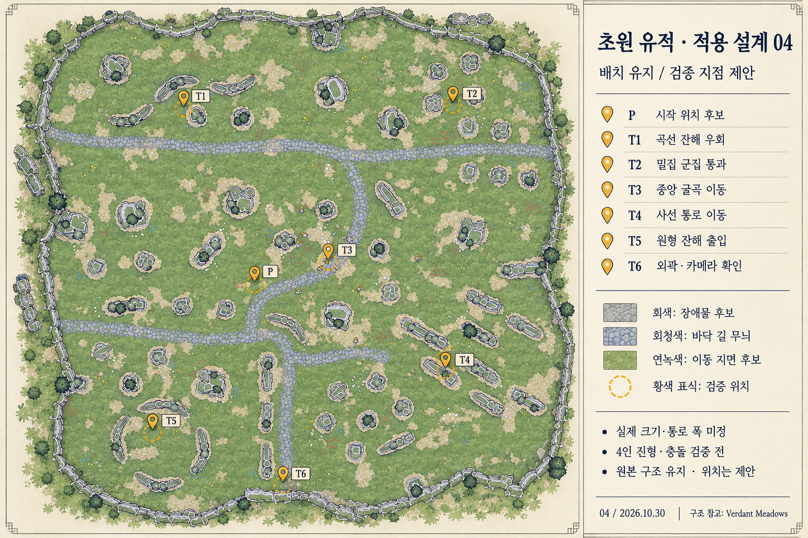

# 초원 유적 — 우리 게임 적용 설계 04

2026-10-30 KST. **기본 도형 제작을 위한 제안**. 사용자 요청 ‘다음 단계’를 03 분석 이후의 적용 설계로 진행했다. 실제 게임 구현이나 수치 확정은 아니다. 이번 범위는 L0 기획·시안이며 코드·데이터 형식·상태 소유권은 바꾸지 않는다. 실제 유한 맵·충돌·생성 구현 시에는 개발 워크플로우에 따라 재분류한다.

## 이번 단계에서 구체화한 것

| 구분 | 내용 |
|---|---|
| 사용자 요구 | Verdant Meadows와 유사한 맵 구성, 중간중간 벽·돌, 건축설계도 표현, 다음 단계 진행 |
| 원본 관찰 | 불규칙 외곽, 전역 군집, 위 가로 길과 굽은 연결로, 지역별 잔해 형태 차이. [03 분석](3D배경-VerdantMeadows-구조분석-03.md) 참조 |
| 이번 제안 | 길 밖 풀밭도 이동 지면으로 사용, 내부 돌 군집과 외곽은 이동 차단 후보, 시작 위치 P와 검증 위치 T1~T6, 최대 진형 기반 크기 비교 |
| 미정 | 최종 좌표·장애물 개수와 충돌 외곽·월드 단위·카메라·투사체/엄폐 정책·스폰 상세 알고리즘 |

03은 원본을 이해하는 자료이고 04는 그 구조를 우리 게임에서 어떻게 시험할지 정한 적용 지시서다. 지금 배치는 원본에 가까운 시험 후보이며 독자적인 최종 레벨 배치를 확정한 것이 아니다. 지면을 이동 가능하게 해석하는 것은 우리 게임에 대한 제안이지 원작 동작을 확인한 사실이 아니다.

## 유지할 구조와 허용하는 조정

다음 특징은 검증 과정에서도 유지할 기준이다.

- 위쪽 가로 길 → 굽어진 중앙 연결 → 하부 길·남쪽 분기의 관계.
- 왼쪽 위 곡선 잔해, 오른쪽 위 소형 군집, 오른쪽 아래 사선 잔해, 왼쪽 아래 끊어진 원형 잔해.
- 내부 전역의 다양한 군집과 그 사이 열린 바닥. 중앙에 거대한 빈 공터를 새로 만들지 않는다.
- 불규칙한 외곽과 지역마다 다른 밀도. 균일한 외곽 순환 통로나 반듯한 직사각형으로 바꾸지 않는다.

통과가 어려우면 전체 크기 비교 → 해당 통로 양쪽 군집 간격 조정 → 충돌 윤곽 단순화 순서로 원인을 분리한다. 조정한 군집과 이유를 기록한다. 돌을 지워 밀도를 크게 줄이거나 원형 잔해를 없애는 것은 핵심 구조 변경이므로 자동 처리하지 않는다. 큰 변경이 필요한 경우 기존 사용자 의도와 충돌하는 점을 먼저 설명한다.

## 우리 게임의 바닥과 장애물

| 요소 | 적용 제안 | 기본 도형 단계의 표현 |
|---|---|---|
| 녹색 바닥·흙 무늬 | 경계 안에서 장애물을 제외한 연속 이동 지면 | 하나의 평면, 색으로만 변화 |
| 돌바닥 길 | 방향을 기억하는 바닥 무늬, 별도 이동 보너스 없음 | 바닥과 같은 높이, 길 가장자리 충돌 없음 |
| 내부 돌·잔해 | 파티와 적이 돌아가는 장애물 후보 | 원·캡슐·단순 다각형으로 단순화, 시각 모양과 실제 차단 외곽을 겹쳐 표시 |
| 곡선·원형 잔해 | 조각별 차단, 사이의 큰 개구부 유지 | 끊어진 원형 전체를 원판 충돌로 채우지 않음 |
| 외곽 돌 경계 | 유한 이동 영역의 경계 후보 | 원본의 큰 굴곡 유지, 잔돌마다 톱니 모양 충돌을 만들지 않음 |
| 작은 풀·꽃 | 바닥 장식 | 충돌 없음, 임시 도형 단계에서 생략 가능 |
| 나무·큰 식생 | 시야 가림 검증 대상 | 단순 실루엣, 캐릭터 발밑 가림 확인 |

‘낮은 돌벽’은 캐릭터를 볼 수 있도록 높이를 제한하려는 표현이다. 넘어가기·파괴·점프를 의미하지 않는다. 전체 외곽을 두꺼운 숲으로 다시 덮지 않는다.

## 시작 위치와 여섯 검증 지점

P는 중앙 연결로 왼쪽의 열린 지면에 둔 **첫 시험 위치 후보**다. 시작을 위해 주변 장애물을 제거하지 않는다. 실제 최대 파티를 놓아 겹치면 같은 지역 안에서 위치를 조정한다. 그림의 원 크기는 파티 반경·안전 거리·충돌 범위가 아니다.

T1~T6은 검증할 주변 영역을 가리킨다. 마커 끝점은 캐릭터 배치 좌표가 아니며, 특히 T4는 잔해 위를 가리킨다. 실제 출발·도착 점은 기본 도형에서 양쪽의 유효 지면에 따로 잡는다.

| 지점 | 시험할 움직임 | 실패로 볼 상황 | 우선 조정 |
|---|---|---|---|
| P 시작 후보 | 1~4인 배치, 세 진형으로 시작·정비 후 출발 | 처음부터 겹침·동료가 돌 안에 생성 | 동일 지역의 시작 후보 이동 |
| T1 곡선 잔해 | 양끝 우회, 접근 방향을 바꿔 반복 | 휘어진 안쪽에서 걸리거나 추종이 돌을 가로지름 | 충돌 윤곽·진형 전체 이동 검사 |
| T2 소형 밀집 군집 | 서로 다른 간격의 통로를 전후·좌우 이동 | 한 명만 통과, 끼임, 진형 자동 찌그러짐 | 전체 스케일·해당 군집 간격 비교 |
| T3 중앙 굴곡 | 길 따라 이동 및 풀밭으로 가로질러 방향 전환 | 길 밖 이동이 막히거나 방향 전환 때 동료가 충돌 | 바닥 규칙·추종 궤적 확인 |
| T4 사선 잔해 | 사선 통로를 양방향으로 지나고 끝에서 회전 없이 방향 전환 | 가로 폭만 계산해 사선에서 동료가 벽과 겹침 | 통로 법선 방향의 전체 진형 폭 측정 |
| T5 원형 잔해 | 모든 보이는 큰 개구부를 조사하고 진입·이탈 후보 시험 | 들어갈 수 있으나 나오지 못함, 원형 내부가 충돌로 채워짐 | 개구부·조각별 충돌·왕복 경로 확인 |
| T6 외곽 | 아래쪽 경계와 모서리 접근, 경계 따라 이동 | 슬롯 이탈, 떨림, 화면 밖 빈 지면, 근접 스폰 | 경계·카메라·생성 후보를 함께 조정 |

T6만 통과했다고 모든 외곽이 통과한 것으로 보지 않는다. 네 방향·돌출부·오목부에 같은 검사를 확장한다. 기본 도형 이후에도 다른 군집을 생략하지 않고 전체 연결성을 확인한다.

## 파티 크기 기준

확인 근거: [진형 코드](../../UnityMigration/Runtime/DSGame.Formation.cs), [전투 코드](../../UnityMigration/Runtime/DSGame.Combat.cs), [진형 기획](웨이브-진형-실험.md). 아래는 로컬 저작 코드 기준이며 실행 프로젝트와의 동기화 비교는 하지 않았다.

| 4인 진형 | 캐릭터 중심의 가로 범위 | 세로 범위 |
|---|---|---|
| 균형 | 48 | 48 |
| 쐐기 | 96 | 96 |
| 횡대 | 144 | 0 |

현재 진형은 화면 위쪽 고정이고 이동 방향에 따라 회전하지 않는다. 위 숫자는 기존 논리 좌표의 중심 간격이며 캐릭터 몸체·충돌·추종 지연 여유가 포함되지 않는다. 미터로 옮기지 않는다. 전투 코드의 피격 반경을 이동 충돌 반경으로 자동 전용하지 않는다.

기본 도형에서 캐릭터 이동 반경 r과 추종 중 추가 여유 m을 별도로 정한다. 직선 통로 폭을 잴 때 통로를 가로지르는 단위 방향 n에 대해, 각 슬롯 오프셋 o의 투영 최대값과 최소값 차이에 2r와 2m을 더한 폭을 비교 기준으로 삼는다. 세 진형 모두와 1~4인 재중심 배치를 확인한다. 이는 시험 폭을 정하는 기하학적 기준이며 완성된 이동 알고리즘이 아니다. 굽은 통로와 동적인 추종은 실제 궤적으로 추가 확인한다.

죽은 슬롯을 없애 폭이 갑자기 줄어들도록 취급하지 않는다. 같은 자리 부활과 다음 진형을 수용할 공간을 함께 검토한다. 좁은 길에서 자동 일렬 전환·자동 회전·개별 동료 순간이동은 기존 진형 규칙을 바꾸므로 이번 기본안으로 도입하지 않는다.

## 크기와 카메라를 정하는 실험 순서

1. 전체 지도 구조를 평면 위에 임시 도형으로 옮긴다. 원본과 비교한 객체 목록을 만든 뒤 개별 충돌 후보를 연결한다. 원본 픽셀 또는 생성 이미지의 색을 곧바로 충돌 데이터로 변환하지 않는다.
2. 실제 UI와 임시 캐릭터를 놓고 고정 방향 카메라 후보를 비교한다. 첫 비교 제안은 지면에서 올려 잰 45도와 55도의 직교 카메라다. 투영 방식·각도는 채택 전이며 동작 검증을 통해 바꿀 수 있다.
3. T2·T4·T5의 주요 통로를 측정한다. 가장 제한적인 필수 통로가 세 진형의 전체 점유 폭보다 여유 있게 넓어지는 전체 스케일을 기준 S0 후보로 잡는다. 보이는 작은 틈 모두를 통과 가능하게 넓히지는 않는다. 필수 통로와 단순 장식 틈을 도면에 명시한다.
4. S0의 0.85배·1.00배·1.15배를 비교하는 안으로 시작한다. 이 배율은 이번 실험 제안이며 원작 수치가 아니다. 스케일은 먼저 지도에만 적용하고 캐릭터·이동 속도·카메라는 고정하여 영향을 분리한다. 좁은 후보에서 실패하면 실패로 기록한다.
5. 통로 판정이 끝나면 카메라 크기를 별도 조정한다. 화면마다 파티·공격 예고·가려지는 면적과 스폰 가능한 지면을 확인한다. 지형 변경과 카메라 변경을 동시에 해서 원인을 잃지 않는다.
6. 기준 후보의 이동 시간을 측정한다. P→T2, P→T4, T4→T5, 외곽 한 방향 접근 등을 같은 입력으로 비교한다. 현재 140 논리 단위/초는 보존 기준이며 맵 이미지에서 시간을 추정하지 않는다.

기록 항목: 지도 후보 식별자·소스 지문·스케일·캐릭터 반경·카메라 투영/각도/크기·화면 비율·파티 수/진형·통로·최소 여유·왕복 성공·겹침·이동 시간·이미지 캡처. 16:9·19.5:9·4:3를 포함한다. 현재 수치 측정 결과는 모두 NOT_RUN이다.

## 이동·적·공격을 붙일 때의 순서

**먼저 파티 이동만 시험한다.** 장애물을 가로지르지 않으면서 진형을 유지하고 양쪽으로 우회할 수 있는지 확인한다. 중심점만 검사하거나 프레임 마지막 위치만 잘라내는 것으로 완료 처리하지 않는다. 실제 추종 궤적·높은 이동량·정비 후 진형 변경·부활을 포함한다.

**그다음 적의 접근을 시험한다.** 현재 적 생성·재배치는 파티와 화면 크기 중심이며 지형을 고려하지 않는다. 내부 돌을 배치했다고 적이 자동 우회하지 않는다. 일반 적·돌진 적·폭발 적·추가 생성·재배치가 같은 유효 지면 기준을 사용하는지 별도 설계한다. 접근 불가한 위치, 장애물 안, UI에만 가려진 근접 위치를 생성 후보로 취급하지 않는다. 후보가 없으면 제한된 재시도 후 실패·지연을 기록하고 누적 적을 한 번에 쏟지 않도록 상한 정책을 정한다. 지금 상한이나 알고리즘을 확정하지 않는다.

**공격 차단은 전투 연결 전에 결정한다.** 이동 장애물이 투사체·근접·폭발·연쇄·시야를 어떻게 막는지 효과별 정책표가 필요하다. 아직 미정이므로 이동 전용 시험에서 엄폐가 작동한다고 표현하지 않는다. 현재 공격이 돌을 무시한다는 사실을 완성 규칙으로 자동 채택하지 않는다. 기존 장비 성능과 전투 규칙을 조용히 바꾸지 않는다.

## 기본 도형 단계의 완료 조건

| 단계 | 산출물 | 완료 판단 |
|---|---|---|
| 배치 | 군집 ID·위치·형태·충돌 후보 표, 원본 대비 평면 캡처 | 모든 주요 군집과 길 관계를 대조하고 누락 이유 기록 |
| 파티 | 세 진형·1~4인·사망/부활·정비 전환·각 통로 이동 기록 | 내부/외곽 겹침과 갇힘을 수정, 실제 입력·프레임 확인 |
| 카메라 | 세 화면 비율의 중앙·군집·경계 캡처 | 발밑·공격 표시 가독성, 지면 끝 노출 확인 |
| 적 | 종류별 접근·돌진·스폰·재배치 기록 | 충돌 밖 생성, 접근 가능, 실패/지연/실제 생성 수 기록 |
| 전투 | 공격별 지형 정책과 기존 효과 회귀 검사 | 정책·표현·실제 판정 일치 |
| 한 판 | 10웨이브·정비·재시작 실제 기록 | 위 요소가 런 전체에서 유지됨. 재미·기기 성능은 별도 |

이번 완료 범위는 위 단계를 위한 **설계 지시서와 검증 위치 시안**이다. 위 산출물은 아직 제작하지 않았다. 실제 Unity 기본 도형 작업에서는 대상 프로젝트와 로컬 원본 차이를 먼저 확인하고 전용 시험 장면으로 분리할지 결정한다. 자동 동기화·씬 덮어쓰기는 하지 않는다.

## 시각 비교와 제작 근거

- 생성 입력: [Verdant Meadows 원본](../art/maps/references/VerdantMeadowsFullMap.png) 한 장. 실제 내장 image_gen에 전달했고 01·02 시안을 재사용하지 않았다.
- [출처와 해상도](3D배경-VerdantMeadows-구조분석-03.md), [04 프롬프트](../art/maps/meadow-application-plan-04-prompt.txt).
- 원본 대비 시각 확인 PASS: 불규칙 외곽, 전역 군집, 상부 가로 길·중앙 굴곡·하부 분기, 북동 소형·남동 사선·남서 원형 특징 유지.
- 생성 결과의 잔여 차이: 외곽 식생이 더 강조되고 일부 세부 윤곽·간격이 변했다. 원본의 정밀 도면으로 쓰지 않는다. 마커는 영역 지정이며 정확한 출발 좌표가 아니다.
- P·T1~T6 표기와 한국어 범례 시각 확인 PASS. 통과 가능성·카메라·스폰·정밀 좌표·Unity 검증은 NOT_RUN.
- [검증 기록](../reviews/우리맵-적용설계-04-20261030.md).
