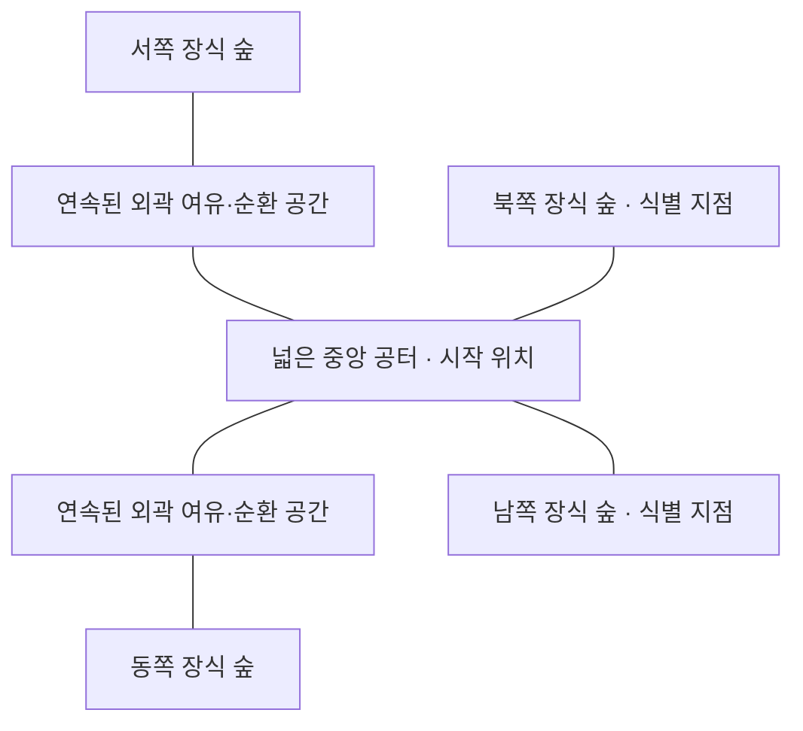

# 첫 3D 숲 맵 구성 기준안

> 현재 참조: [원본 구조 분석 03](3D배경-VerdantMeadows-구조분석-03.md). 아래의 단순 공터 및 02안 방향은 이전 제안으로, 현재 시각 설계 조건이 아니다.

> 2026-10-30 후속 변경: 사용자가 내부 벽·바위를 요청했다. 당시 시각 설계는 [평면설계 02](3D배경-첫맵-평면설계-02.md)를 따른다. 아래의 내부 장애물 없음·지형 차단 없음·장애물 후속 도입은 이전 제안으로 보존하며, 현재 방향을 제한하지 않는다. 장애물 개수·치수·공격 차단 정책과 구현은 미확정이다.

작성일: 2026-10-30 KST. 상태: **제작 전 제안**. 사용자 요청에 따라 맵의 형태와 제작 범위를 정리한 문서이며, 구현 착수·최종 채택·플레이 검증 완료를 의미하지 않는다.

첫 맵은 **고정 배치의 넓은 숲 공터 하나**를 제안한다. 공터 안에서 자유롭게 움직이며 기존 10웨이브를 진행하고, 숲의 밀도와 낮은 소품으로 장소 변화를 만든다. 초기에는 내부의 이동 차단물을 두지 않고 외곽 경계만 설계한다. 내부 장애물과 좁은 길, 고저차, 무작위 생성은 후속 검증 대상으로 둔다.

[꿈꾸는 섬 참고 범위](3D배경-꿈꾸는섬-참고범위.md)는 외형의 기준이며, 본 문서는 **우리 게임의 공간과 이동 조건**을 다룬다. 꿈꾸는 섬의 지도 좌표나 The Spell Brigade의 미확인 맵 생성 방식을 가져오지 않는다.

## 확정 사항과 이번 제안

| 구분 | 내용 |
|---|---|
| 사용자 요청 | 아직 제작 전이다. 3D 배경과 맵을 어떻게 만들지 준비 문서로 정리한다 |
| 기존 게임 | 1~4인 파티, 세 진형, 자동 전투, 10웨이브·기본 전투 435초, 웨이브 사이 정비 |
| 이번 제안 | 고정된 유한 맵 한 곳, 평평한 바닥, 넓은 중앙과 외곽 순환 공간, 내부 충돌 장애물 없는 첫 버전 |
| 아직 미정 | 유한 맵 제안의 최종 채택, 맵 치수·카메라·캐릭터 표현·장애물·성능 목표 |

기존 규칙은 [현재 상태](../현재상태.md), [할일](../../할일.md), [웨이브와 진형](웨이브-진형-실험.md)을 따른다. 이번 문서로 웨이브 시간·적 수·보상·장비 규칙을 바꾸지 않는다.

## 현재 코드가 전제하는 공간

문서 작성 시 로컬 저작 원본을 읽은 결과다. 실행 중인 Unity 프로젝트와의 동기화나 현재 플레이 검증은 수행하지 않았다.

| 현재 동작 | 근거 | 맵 도입 시 필요한 검토 |
|---|---|---|
| 파티 중심이 입력에 따라 계속 이동 | `DSGame.Combat.cs`의 `Simulate` | 외곽에서 중심과 전체 진형이 안전하게 멈추는 규칙 |
| 캐릭터가 중심과 진형 오프셋을 따라 이동 | `DSGame.Formation.cs`, `Simulate` | 중심만 제한하면 동료가 경계 밖으로 나갈 수 있음 |
| 파티 중심에서 화면 크기 기반 거리로 적 생성 | `DSGame.Combat.cs`의 `Spawn` | 유한 맵에서 외곽 밖·장식 숲 안에 생성되지 않도록 변경 필요 |
| 멀어진 일부 적을 화면 바깥에 재배치 | 같은 파일의 `Recycle` | 일반 생성과 동일한 유효 위치 조건 필요 |
| 이동과 전투 계산은 평면 좌표 | [코드 구조](../구조.md), 관련 런타임 코드 | 3D 표현과 실제 판정의 위치 대응 필요 |

따라서 유한 맵은 단순히 바닥 모델을 교체하는 작업이 아니다. 구현 단계에서는 경계·스폰·재배치·카메라를 함께 설계하고 프로젝트 워크플로우에 따라 작업 규모와 독립 검토 필요성을 다시 분류한다. 현재 단계에서는 데이터 스키마나 상태 소유권을 확정하지 않는다.

## 고정된 공터를 먼저 제안하는 이유

| 선택지 | 장점 | 지금의 부담 | 판단 |
|---|---|---|---|
| 무한 평면과 반복 배경 | 현재 이동 전제와 가까움 | 이동 중 소품 반복·재배치·숲 밀도 관리 필요, 맵 전체 구조 검증 어려움 | 비교 대안으로 보존 |
| 고정된 유한 공터 | 같은 위치에서 화면·이동·적 밀집을 반복 비교하기 쉬움 | 경계 근처 스폰과 진형 처리 필요 | 첫 맵 권장안 |
| 공터 여러 개와 통로 | 이동 중 장소 변화가 큼 | 병목·진형 해체·적 우회·스폰 고립 가능성 | 후속 확장 |
| 무작위 맵 | 반복 플레이의 배치 변화 | 연결성·도달 가능성·막힌 길·검증 시드 관리 필요 | 첫 버전 범위 제외 |

유한 공터가 구현 비용이 가장 적다는 뜻은 아니다. 첫 3D 맵의 화면과 동작을 반복 비교하기 쉽다는 이유로 선택한 제안이다. 제작 전에 맵 구조보다 배경 외형만 먼저 시험하고 싶다면 현재 무한 평면을 유지한 시각 시안도 가능하며, 이를 유한 맵 검증과 혼동하지 않는다.

## 전체 공간 구성

지형은 모서리가 완만한 직사각형 계열을 기준 후보로 삼는다. 시각적 숲 경계에는 불규칙함을 주되, 초기 이동 가능 영역에 깊은 홈·좁은 목·작은 막다른 곳을 만들지 않는다. 정확한 외곽 형상은 기본 도형 비교에서 정한다.

| 공간 | 역할 | 첫 버전 구성 |
|---|---|---|
| 중앙 전투 공터 | 시작과 기본 전투, 효과 가독성 확인 | 가장 넓고 바닥이 잘 보이는 영역 |
| 중앙 주변의 순환 공간 | 적을 피해 방향을 바꾸고 돌아올 여유 | 중앙과 끊김 없이 연결. 나무로 막힌 별도 원형 통로가 아님 |
| 외곽 여유 공간 | 경계에 닿기 전 방향을 바꿀 공간 | 진형 전체와 적 접근을 고려한 폭 확보 |
| 장식 숲 | 맵의 경계와 분위기 | 이동 영역 바깥에 큰 나무와 관목 배치 |
| 방향 식별 지점 | 비슷한 숲에서 위치를 기억 | 외곽에 서로 다른 색·형태의 소품 묶음. 기능 없는 시각 표식 |

위 도식은 역할과 인접 관계만 표현한다. 선은 실제 길이나 이동 허가를 뜻하지 않으며 장식 숲은 이동 영역 밖이다. 중앙·순환·외곽 여유 공간 사이에는 초기 버전에서 벽이 없다.

## 맵 치수를 정하는 방법

현재 단계에서 미터나 타일 개수로 고정하지 않는다. 기존 코드의 좌표값을 새 3D 월드 단위로 그대로 쓰지 않는다.

1. 임시 캐릭터와 기존 UI가 있는 상태에서 카메라 후보를 정한다.
2. 각 화면 비율에서 실제 보이는 바닥 범위와 UI가 덮는 범위를 구분한다. UI 아래 가려진 공간을 안전한 전투 시야로 세지 않는다.
3. 네 명의 세 진형을 모두 놓고 이동·회전 없는 방향 전환·추종 지연을 포함한 최대 점유 영역을 관찰한다.
4. 중앙과 외곽을 이동하는 데 걸리는 시간, 적과의 거리, 방향을 바꿀 여유를 비교해 맵 크기를 정한다.
5. 확정 후보에 단위·좌표 변환·측정 카메라·화면 비율을 함께 기록한다.

비교는 좁음·중간·넓음의 세 크기 후보로 시작하는 안을 권장한다. 구체적인 배율은 모형 설계 시 정한다. 맵이 너무 작아 생성 가능한 화면 밖 영역이 부족하거나, 너무 넓어 외곽과 식별물을 거의 만나지 못하면 목적에 맞게 수정한다.

## 이동과 외곽 경계

| 항목 | 첫 버전 제안 | 확인할 실패 상황 |
|---|---|---|
| 이동 평면 | 모든 전투 판정을 같은 바닥 평면에서 수행 | 겉보기 단차와 실제 이동의 불일치 |
| 파티 경계 | 살아 있는 캐릭터만이 아니라 사망 슬롯·부활·다음 진형까지 고려한 안전 영역 설계 | 끝의 캐릭터가 숲 안으로 들어감, 부활 직후 경계 밖 배치 |
| 경계 입력 | 바깥 방향 이동은 막고 경계를 따라가는 입력 성분은 유지하는 안 | 모서리 떨림·끌림·순간이동 |
| 시각적 경계 | 바닥 변화와 숲의 시작으로 끝을 읽을 수 있게 함 | 아무 표시 없이 멈추는 보이지 않는 벽 |
| 내부 장애물 | 첫 버전은 없음. 키 큰 소품은 이동 공간 밖에 둠 | 충돌 없는 큰 나무를 캐릭터가 관통 |
| 낭떠러지·물·경사 | 첫 버전에는 게임 기능으로 도입하지 않음 | 떨어짐·수영·점프 등 범위 확대 |

경계 처리의 구체 알고리즘과 충돌 모양은 구현 설계 대상이다. 캐릭터 각각을 독립적으로 잘라내 진형을 찌그러뜨리는 해결책을 기본으로 삼지 않는다. 시각적 수관이 이동 영역 위로 넘어오는 경우에는 실제 발밑 가림을 별도로 확인한다.

## 적 생성과 재배치

생성 정책은 맵 구조와 함께 정해야 한다. 기존의 파티 중심 원형 생성 공식을 그대로 사용하면 유한 경계 바깥에 적이 놓일 수 있다.

- 일반 생성과 멀어진 적의 재배치 모두 **이동 가능한 지면·파티 접근 가능성·시야·최소 안전 거리**를 확인한다.
- 경계 근처에서는 지도 안에 남는 방향에서 후보를 찾는다. 좌표를 경계로 강제로 당겨 한 점에 적을 쌓지 않는다.
- 화면 밖이라는 기준은 실제 카메라가 보여주는 영역을 기준으로 한다. 하단 UI에 가려졌다는 이유만으로 캐릭터 가까이에 생성하지 않는다.
- 유효 후보가 없으면 제한된 횟수로 재시도하고, 실패를 기록한 뒤 다음 갱신으로 넘기는 안을 검토한다. 한 프레임에서 무한 재시도하지 않는다.
- 생성 실패를 성공으로 세지 않고, 뒤늦게 누적된 적이 한꺼번에 쏟아지지 않게 상한을 둔다. 상한과 최대 지연은 미정이다.
- 기본 시간제 웨이브 종료는 유지한다. 지속적인 생성 지연으로 실제 전투 압력이 낮아지면 해당 맵·스폰 조합을 실패로 판정하고 재설계한다. 남은 예산의 종료 시 처리도 명시해야 한다.
- 돌진·폭발 적과 추가 생성, 재배치도 같은 경계 검증에서 제외하지 않는다. 경계 밖으로 밀리거나 방향을 바꾸지 못하는 적은 별도 검사한다.

숲을 적만 통과하는 통로로 쓰는 안, 외곽 별도 생성 구역을 두는 안은 첫 기준안에 포함하지 않는다. 필요하다면 가시 경계와 이동 규칙을 다시 설명할 수 있게 설계한다.

## 공격과 지형의 관계

첫 버전에는 내부 벽이나 나무 충돌이 없으므로 지형에 의한 시야 차단·엄폐·투사체 차단을 새로 도입하지 않는 안을 제안한다. 외곽에는 전투 대상이 없도록 생성·이동 정책을 맞춘다.

투사체의 경계 통과·제거 시점, 폭발 범위가 맵 밖으로 나가는 표시, 돌진의 경계 처리, 바닥 공격 표시의 3D 투영은 구현 전에 별도로 정한다. 장식 숲의 깊이 가림만으로 공격 판정이 차단됐다고 착각하게 만들지 않는다. 기존 장비 효과를 조용히 바꾸지 않고 변경이 필요한 항목을 명시한다.

## 카메라와 배경 표현

- 고정된 방향으로 파티를 따라가는 시점을 첫 후보로 둔다. 카메라 회전은 초기 범위에서 제외하는 안이다.
- 맵 가장자리에서 카메라를 제한할지 계속 파티를 따라갈지는 시야와 스폰 정책을 함께 비교해 결정한다.
- 카메라가 볼 수 있는 맵 밖에는 장식 숲과 바닥이 충분히 이어지게 한다. 화면에 검은 빈 공간이나 지면 끝이 노출되지 않게 한다.
- 높은 소품을 중앙에 두지 않고, 파티 뒤로 겹치는 나무는 우선 배치·크기 조정으로 해결한다. 자동 투명화는 필요성이 확인된 뒤 검토한다.
- 바닥의 원형 공격 범위가 비스듬한 카메라에서 타원처럼 보이는 것은 가능하지만, 표시와 실제 평면 판정은 같은 위치에 있어야 한다.

## 한 판의 진행

| 시점 | 제안 |
|---|---|
| 런 시작 | 중앙의 동일한 시작 지점. 위치·배치 비교를 위해 고정 |
| 웨이브 진행 | 같은 맵에서 기존 전투 규칙 유지. 지역 이동 목표 추가 없음 |
| 웨이브 사이 정비 | 기존 정비 화면과 시간 정지 유지. 별도 야영 맵 이동 없음 |
| 진형 변경 후 출발 | 선택 진형 전체가 경계 안에 놓이는지 확인. 필요 위치 보정은 명시적으로 설계 |
| 사망·부활 | 기존 슬롯 규칙 유지, 부활 위치가 유효 지면인지 확인 |
| 승리·패배 | 기존 결과 흐름 유지. 탈출구 도착 조건 추가 없음 |
| 재시작 | 동일한 맵·시작 위치로 복구. 무작위 장식 변화는 첫 비교에서 제외 |

## 장식과 이동 영역의 구분

| 요소 | 첫 버전의 위치·역할 | 피할 구성 |
|---|---|---|
| 큰 나무·큰 바위 | 이동 영역 밖의 외곽 | 길 중앙에 두고 충돌 없이 통과시킴 |
| 관목 | 외곽의 큰 소품 사이 | 적 실루엣을 넓게 덮음 |
| 낮은 풀·꽃·낙엽 | 이동 가능한 바닥의 소량 장식 | 위험 표시·전리품과 비슷한 형태·색 |
| 흙길 무늬 | 방향과 공간 변화를 읽는 표시 | 길 밖은 못 간다는 잘못된 인상 |
| 외곽 식별물 | 위치를 기억하는 시각 단서 | 상호작용 가능한 보상이나 출구처럼 표시 |

길 무늬는 경로 안내이지 이동 가능한 범위의 유일한 표시가 아니다. 어디든 이동 가능한 공터와 실제 경계는 화면에서 구별돼야 한다.

## 구현 전 필요한 산출물

1. 이동 가능 영역·외곽 숲·중앙 시작점을 표시한 평면 설계도.
2. 카메라별 보이는 범위와 UI 가림 영역, 장식 숲이 필요한 범위를 겹쳐 본 도식.
3. 네 명의 세 진형에 대한 중앙·직선 경계·모서리 점유 예시.
4. 일반 생성·추가 생성·적 재배치의 유효 후보와 실패 처리 규칙.
5. 장식과 충돌의 구분표, 공격·돌진·부활의 경계 정책.
6. 맵 크기 비교와 실제 입력·화면·성능 검증 계획.

첫 설계도는 원작 지도를 재현하는 도면이 아닌 우리 게임의 도면이다. 좌표·데이터 형식·씬 소유권을 정하는 구현 설계에서는 [개발 워크플로우](../workflows/development.md)에 맞는 독립 검토를 거친다.

## 단계별 범위와 통과 조건

| 단계 | 작업 | 통과 조건 |
|---|---|---|
| 준비 | 본 기준안과 외형 참고 범위 정리 | 확정·제안·미정 구분, 제작 전에 필요한 결정 확인 |
| 기본 도형 | 평면·임시 경계·카메라·임시 캐릭터 | 중앙과 경계에서 진형·화면이 읽힘 |
| 동작 연결 | 이동 경계·생성·재배치·공격 표시 연결 | 경계 밖 캐릭터·적, 접근 불가 적, 겹쳐 생성되는 적이 없음 |
| 외형 적용 | 대표 나무·바닥·관목과 제한된 장식 | 다수 적·효과가 있어도 전투 정보가 보임 |
| 전체 런 | 실제 10웨이브와 정비·부활·재시작 | 경계 악용·누적 생성·화면 오류와 성능 문제를 확인하고 수정 |
| 확장 판단 | 내부 장애물 또는 두 번째 구역 중 하나 비교 | 처음 맵보다 조작·선택에 도움이 되는지 판단 |

현재 실제 게임 검증은 모두 **NOT_RUN**이다. 16:9·19.5:9·4:3에서 중앙·가장자리·모서리·최대 파티·밀집 전투를 확인하고, 물리 기기 성능은 별도 환경 확보 후 측정한다. 생성 시도·실패·지연·실제 생성 수를 기록해 단순히 오류가 없다는 이유로 통과시키지 않는다.

## 후속 확장과 미정 사항

내부 장애물은 파티와 적의 우회·끼임·스폰 도달 가능성·투사체 정책을 검증한 뒤 추가한다. 여러 공터와 통로는 그 다음이다. 맵이 여러 개 필요해져도 첫 맵의 검증된 소품·규격을 재사용하되, 무작위 생성은 별도 목표로 다룬다.

최종 채택 전에 정할 항목은 유한 공터 방식, 맵 크기와 카메라, 캐릭터 표현, 외곽 이동 정책, 스폰 실패 처리, 목표 기기·성능 수치다. 각 단계마다 새로운 승인 절차를 추가하는 의미는 아니며, 설계 선택이 기존 게임에 미치는 영향을 기록하기 위한 목록이다.

관련 문서: [외형 참고 범위](3D배경-꿈꾸는섬-참고범위.md) · [자료와 레퍼런스 평가](3D배경-신비한숲-분석준비.md) · [문서 검증](../reviews/첫맵-구성기준안-20261030.md).
