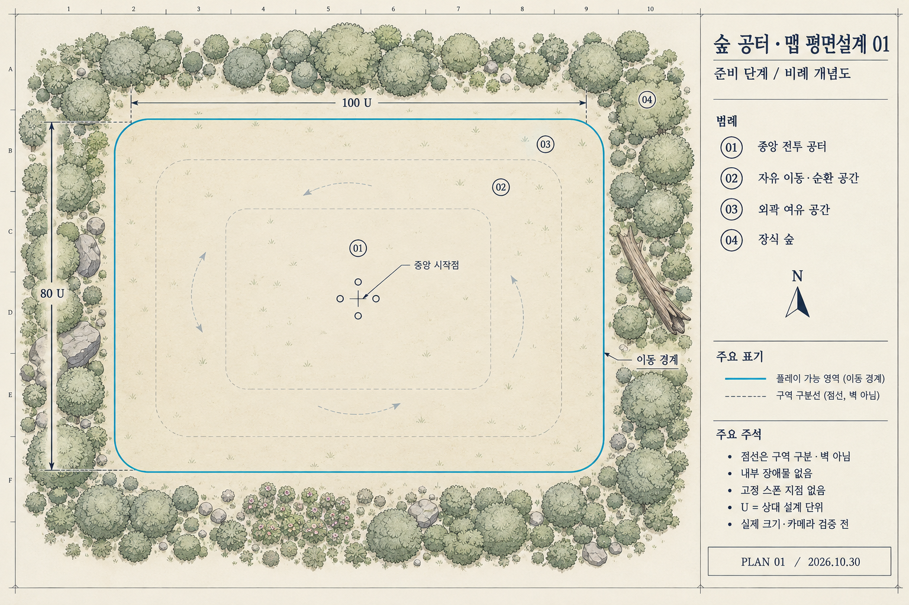

# 숲 공터 맵 평면설계 01

> 상태: 레퍼런스 구조 요구 미충족. [원본 구조 분석 03](3D배경-VerdantMeadows-구조분석-03.md)으로 대체. 아래 02안 연결도 과거 진행 기록이다.

> 비교용 이전 시안. 사용자 요청으로 내부 바위·돌벽을 추가한 [02안](3D배경-첫맵-평면설계-02.md)을 만들었으나 두 시안 모두 03 분석도로 대체했다.

작성일: 2026-10-30 KST. **준비 단계의 비례 개념도**. 사용자 요청에 따라 기존 문서를 시각화했다. 최종 치수·게임 구현·플레이 검증 완료를 뜻하지 않는다.

## 설계 근거

- [첫맵 구성 기준안](3D배경-첫맵-구성기준안.md): 하나의 넓은 유한 공터, 중앙 시작, 내부 장애물 없음, 연속된 이동 공간.
- [꿈꾸는 섬 참고 범위](3D배경-꿈꾸는섬-참고범위.md): 둥근 수관, 나무·관목·풀의 높이 단계, 숲의 밀도와 열린 바닥 대비.
- [신비한 숲 분석 준비](3D배경-신비한숲-분석준비.md): 외형 참고 자료. 원작 지형 좌표와 구조를 복제하지 않는다.

## 이번 시안의 공간 제안

| 구역 | 배치와 역할 | 이동 규칙 |
|---|---|---|
| 01 중앙 전투 공터 | 중앙 시작점과 가장 단순한 바닥. 전투 효과와 파티를 읽는 기준 공간 | 모든 방향으로 이동 |
| 02 자유 이동·순환 공간 | 중앙 주변에서 적을 피하고 돌아오는 공간 | 중앙과 직접 연결, 별도 원형 통로가 아님 |
| 03 외곽 여유 공간 | 이동 경계 안쪽에서 방향을 전환하는 공간 | 다른 구역과 동일한 바닥, 별도 벽 없음 |
| 04 장식 숲 | 이동 경계 밖의 나무·관목·바위 | 플레이 영역 제외 |

청록 실선은 이동 가능 지면의 외곽이다. 점선은 설명용 구역 구분이며 게임에 놓는 벽·차선이 아니다. 화살표는 가능한 이동의 예시로, 일방통행이나 강제 이동 경로를 뜻하지 않는다. 중앙 네 원은 파티를 뜻하는 기호이며 진형의 실측 점유 범위가 아니다.

## 비율과 치수의 의미

이번 그림을 만들기 위한 **상대 설계 단위 U**를 새로 제안했다. 1 U는 미터·타일·기존 게임 좌표와 대응하지 않는다.

| 항목 | 그림 제작에 사용한 제안 |
|---|---|
| 이동 가능 영역의 외접 크기 | 가로 100 U × 세로 80 U |
| 중앙 구역 목표 비율 | 가로 48 U × 세로 32 U |
| 외곽 여유 공간 목표 폭 | 경계 안쪽 약 8 U |
| 모서리 | 완만하게 둥글게 처리, 정확한 반경 미정 |
| 숲의 바깥 범위 | 화면을 구성하는 예시이며 실제 카메라 가림 범위 미검증 |

이 수치는 이미지의 구성 의도를 설명한다. 생성 이미지의 픽셀 길이·치수선 끝점·점선 위치는 정확한 축척을 보장하지 않는다. 제작 시에는 이 그림을 측량하거나 충돌 경계로 추출하지 않고 별도 좌표 도면을 작성한다. 특히 100:80 비율과 각 구역 폭은 실제 화면·이동 시간·4인 진형·스폰 후보 확보를 비교한 뒤 수정할 수 있다.

## 방향 식별과 외곽 장식

이번 시안에서 새로 제안한 식별물은 북쪽의 큰 나무 군집, 동쪽의 쓰러진 통나무, 서쪽의 바위 묶음, 남쪽의 낮은 꽃·관목이다. 모두 이동 경계 밖에 둔다. 출구·보상·상호작용 시설이나 적의 고정 생성 지점을 의미하지 않는다. 화면의 위쪽을 북쪽으로 표기했지만 실제 카메라 방향을 확정한 것은 아니다.

큰 수관과 바위는 중앙 전투를 가리지 않게 배치한다. 실제 비스듬한 시점에서는 남쪽 수관이 파티를 가릴 수 있으므로 모형 단계에서 높이·후퇴 거리·수관 크기를 조정해야 한다. 숲의 외곽 폭도 카메라가 보여주는 범위에 맞춰 확장한다.

## 다음 설계에서 확인할 항목

1. 카메라와 UI를 겹쳐 실제 보이는 전투 공간 결정.
2. 네 명의 세 진형을 중앙·직선 경계·모서리에 놓아 점유 범위 확인.
3. 중앙에서 외곽까지의 이동 시간과 회피 여유 비교.
4. 경계 근처의 유효한 적 생성·재배치 후보 확인. 그림에 고정 스폰 위치를 추가하지 않음.
5. 이를 바탕으로 실제 단위와 좌표를 갖는 도면 작성.

이미지는 이미지 생성 도구로 제작한 로컬 보관 시안이다. Unity 씬·코드·데이터는 변경하지 않았다. 검증 결과: [평면설계 검토 기록](../reviews/첫맵-평면설계-01-20261030.md).
