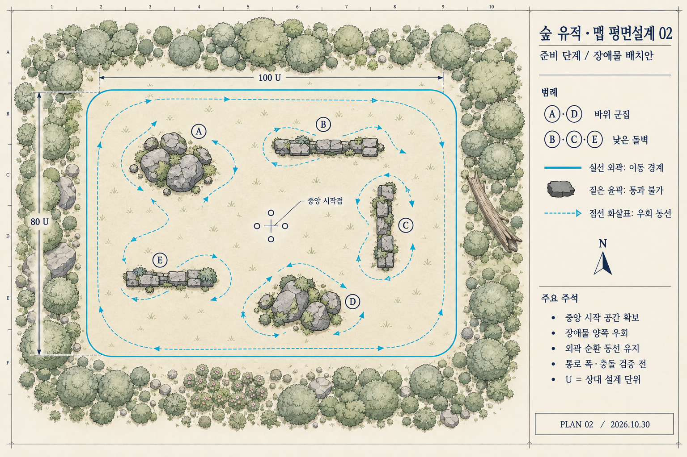

# 숲 유적 맵 평면설계 02

> 상태: 레퍼런스 구조 요구 미충족. [원본 구조 분석 03](3D배경-VerdantMeadows-구조분석-03.md)으로 대체. 기존 자체 조건 확인 PASS는 사용자 레퍼런스 요구 충족을 뜻하지 않는다.

2026-10-30. 준비 단계. 사용자가 빈 공터 대신 맵 중간중간에 벽·돌을 요청하여 내부 장애물을 포함하는 방향으로 수정했다. **장애물 도입은 사용자 요청이며, 아래의 개수·위치·크기는 이번 시안의 제안**이다. 구현 완료를 의미하지 않는다.

## 변경 방향

[01안](3D배경-첫맵-평면설계-01.md)의 넓고 빈 내부에 바위 군집 2개와 낮은 돌벽 3개를 추가했다. 외곽 숲·단일 평면·중앙 시작점은 유지하면서 장애물 양쪽으로 우회하는 선택을 만든다. [기존 기준안](3D배경-첫맵-구성기준안.md)의 내부 장애물 없음·내부 지형 차단 없음 전제는 이번 방향에 적용하지 않는다.

| 표기 | 위치 | 배치 목적 |
|---|---|---|
| A | 북서쪽 바위 군집 | 중앙과 북서쪽 사이 직선 이동을 나누고 양쪽 우회 유도 |
| B | 북쪽 가로 돌벽 | 중앙과 북쪽 외곽 사이에 짧은 차단선 형성 |
| C | 동쪽 세로 돌벽 | 동쪽에서 안쪽·바깥쪽 이동 선택 |
| D | 남쪽 바위 군집 | 남쪽 공간의 이동 방향 변화 |
| E | 남서쪽 가로 돌벽 | 남서쪽 전투 공간과 우회 선택 형성 |

중앙 시작점 주변은 비워 둔다. 모든 장애물은 외곽 경계에서 떨어뜨리고 서로 붙여 방이나 막다른 길을 만들지 않는다. 외곽을 크게 돌아 이동하는 길과 장애물 사이로 가로지르는 길을 함께 남기는 설계 의도다. 그림의 점선은 양방향 이동 가능한 경로 예시이며 일방통행·실제 길 경계·검증된 경로 데이터가 아니다.

## 장애물의 의미와 미정 규칙

- 내부 바위·돌벽은 장식이 아니라 **플레이어와 적 모두 통과하지 못하는 이동 장애물**로 설계하는 안이다. 실제 충돌은 미구현이다.
- 낮은 벽은 캐릭터가 잘 보이도록 높이를 제한하려는 표현이며, 넘어갈 수 있다는 뜻이 아니다. 점프·파괴·상호작용은 이번 시안 범위에 넣지 않는다.
- 돌 사이의 작은 틈과 주변 풀은 외형 표현이다. 작은 틈을 개별 통로로 만들지 않고 단순한 충돌 외곽으로 정리하는 안을 권장한다.
- 공격·투사체·시야·폭발이 벽에 차단되는지는 미정이다. 이동 차단이 곧 엄폐 기능 구현을 의미하지 않는다.
- 스폰과 재배치는 장애물 내부를 제외하고 파티까지 접근 가능한 바닥인지 확인해야 한다. 고정 스폰 지점은 지정하지 않는다.
- 4인 진형과 적이 함께 통과할 실제 여유 폭, 동료 추종·사망 슬롯·부활, 돌진과 경로 탐색이 새 검증 대상이다.

## 상대 비율

100×80 U 외곽 비율은 01안과 비교를 위한 임시 기준이다. U는 미터나 게임 좌표가 아니다. 생성 이미지의 길이를 측량하여 구현하지 않는다.

프롬프트의 배치 목표는 좌하단을 (0,0)으로 보았을 때 A 중심(25,57)·14×11, B 중심(57,62)·22×4, C 중심(74,40)·4×18, D 중심(53,20)·14×10, E 중심(25,30)·16×4 U다. 이는 시각 구성을 위한 입력이며 결과 이미지가 정확히 따르는 좌표 사양이 아니다. 실제 최소 통로 폭은 아직 확정하지 않았다.

다음 단계에서는 카메라와 최대 진형을 놓은 기본 도형에서 통로 폭·양쪽 우회·외곽 순환·적 밀집을 확인한다. 막힘이 발생하면 장애물 크기를 줄이거나 간격을 넓힌다. 외곽 순환만 반복하는 것이 항상 유리해지는지도 비교한다.

## 제작과 확인

내장 이미지 생성 도구로 01안을 편집했다. 기존 이미지는 보존했다. [생성 프롬프트](../art/maps/forest-ruins-plan-02-prompt.txt).

- 시각 확인 PASS: A~E 장애물과 중앙 시작점, 외곽 순환 예시, 범례를 확인.
- 축척·최소 통로 폭·실제 접근 가능성: NOT_RUN. 개념도를 플레이 검증으로 취급하지 않는다.
- Unity 컴파일·플레이·성능: NOT_RUN. 코드와 씬 변경 없음.
- 로컬 문서 검증: [검토 기록](../reviews/첫맵-평면설계-02-20261030.md).
