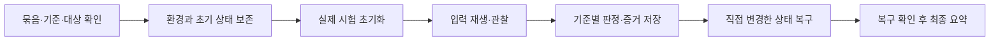

# 맵 제작 워크플로우와 하네스 설계

2026-10-31 KST. 문서 설계 v1.1. 10-30의 v1 단계/필수 사례를 유지하고 011에서 G5 자산 인수 연결을 보충했다. 이번 변경은 문서뿐이다. 현재 구현은 [010 H1 기초 분석](map-harness-h1-foundation.md)까지이며 실제 Unity 맵 실행 하네스는 미구현이다.

## 작업 브리핑

- 상태: v1 설계 검토 이력은 아래 10-30 기록에 보존한다. v1.1의 자산 연결 범위와 검토는 [011 채택 설계](ai-3d-reference-adoption.md)를 따른다. 아래 브리핑의 제작 보류는 당시 작업 범위이며 현재 구현 진행은 010을 참조한다.
- 규모: L1. 문서로 로컬 워크플로우·산출물 규격을 도입한다. 런타임 상태 소유권·데이터 스키마를 적용하는 작업은 아니다. 후속 하네스 구현은 재분류하고 L2 해당 시 사전 설계 검토한다.
- 요구: 제작 전에 레퍼런스 보존, 재현 가능한 검증, 일관된 작업물 형식을 함께 설계한다. 사용자 요청은 이 범위까지이며 실제 제작 착수로 확대하지 않는다.
- 제외: 새 맵 이미지 생성, Unity 조작, 하네스 코드 구현, 전역 설정·외부 서비스·원격 게시.
- 관련 기획: [03 원본 분석](3D배경-VerdantMeadows-구조분석-03.md), [04 적용 제안](3D배경-우리맵-적용설계-04.md). 관찰·제안·미정의 구분을 유지한다.
- 기존 코드/데이터 소유처: `Tools/Verify/run.py`가 문서·데이터·지문과 결과 요약, `unity_check.py`가 기존 게임 실행 검사, `UnityMigration/Editor/DSVerification.cs` 등이 기존 규칙 검사를 담당한다. `PrototypeData.json`과 `DSGame`을 그대로 유지한다.
- 변경 파일: 본 설계, 맵 산출물 규격, 레퍼런스 대응표, 사례 명세, 작업 묶음·시험 사례·결과 양식, 기존 워크플로우와 문서 입구 연결. 기존에는 자유 형식 시안과 일반 검사였고 이후에는 요구→자료→시안→시험→증거를 ID로 연결한다.
- 재사용/신설: 기존 개발 절차·검사 명령·독립 리뷰를 재사용한다. 맵 형식·의미·실패 탐지 계약이 없어 문서 명세를 보충한다. 새 코드 진입점과 CLI 옵션은 이번에 만들지 않는다.
- 실패·취소·생사·전환 경계: 아래 상태 판정과 복구 절을 적용한다. 생사·정비는 향후 시험 사례로 정의하며 이번에 게임 규칙을 바꾸지 않는다.
- 호환성과 복구: 기존 파일·결과·03/04 보존. 새 규격을 과거 결과에 소급해 합격시키지 않는다. 문서 변경을 되돌릴 때 입구 링크와 현재 버전을 함께 되돌리고 검토 이력을 남긴다.
- 검증 계획: 문서 링크 검사 → 대응표/사례/양식 ID 수동 대조 → 소스와 미구현 범위 대조 → validator-client 독립 검토 → 지적 수정. Unity·하네스 동작 검사는 NOT_RUN.
- 미정과 영향: 실제 반경·진형 오차·시간 제한·스폰 거리·성능 예산은 미정이다. 명세 작성은 가능하지만 해당 시험의 합격 판정은 값이 정해질 때까지 BLOCKED다.
- 설계 검토: [검토 기록](../reviews/맵-워크플로우-하네스-20261030.md)에 분리 기록.

## 규칙의 단일 원본

| 문서 | 책임 |
|---|---|
| [개발 절차](../workflows/development.md) | L0/L1/L2, 독립 검토와 역할 라우팅 |
| [레퍼런스 절차](../workflows/reference-design.md) | 사용자 요구·관찰·제안 구분, 원본 직접 입력, 변경 판단 |
| [맵 산출물 규격](../workflows/map-artifact-contract.md) | 파일·도면·표·버전·비교 형식의 일관성 |
| 본 문서 | 단계·하네스 책임·실행/복구·증거·종합 판정 |
| [대응표](맵-레퍼런스-대응표.md) | 보존할 특징과 도면·객체·시험의 연결 |
| [사례 명세](맵-하네스-사례명세.md) | 시험 입력과 관찰·판정·실패 주입 |
| [AI 3D 자산 워크플로우](../workflows/ai-3d-assets.md) | 생성/원본/후처리/Unity 후보/시각 인수/채택 A0~A5 |
| [자산 하네스 설계](ai-3d-asset-harness.md) | 별도 자산 자료·AC/AFI·복구/등록·G5 sidecar 계약 |

## 제작 순서와 통과 기준

현재 산출물의 역할은 아래처럼 고정한다. ‘최신’ 하나로 원본·시안·검증을 섞지 않는다.

| 자료 | 현재 역할 | 상태 |
|---|---|---|
| VerdantMeadowsFullMap.png | REF-VM-001 원본 입력 | 보존, 수정 금지 |
| 01·02 도면 | 요구 불일치 사례의 비교 기록 | 대체됨, 후속 생성 구조 기준으로 사용 금지 |
| 03 도면/분석 | 원본의 정성적 공간 분석 | 참고 가능, 정밀 도면 아님 |
| 04 도면/설계 | 우리 게임의 적용·검증 위치 제안 | 후보, 충돌/좌표 확정 아님 |
| 산출물 규격 v1·본 하네스 설계 | 이후 작업의 작성·검토 기준 | 문서 검토 대상, 검사기 미구현 |
| 실행 맵·공통 배치 데이터·맵 하네스 | [007 준비 배치·도면](map-meadow-007-r001-spatial.md), 후속 실제 동작 | 준비 배치/네 판 작성, 실제 게임·하네스 미구현 |

핵심은 **형식 일관성, 레퍼런스 충실도, 동작 정확성, 실행 증거의 유효성**을 별도 판정하는 것이다. 평균 점수로 서로의 실패를 상쇄하지 않는다.

| 단계 | 입력·작업 | 필수 산출물 | 다음 단계 조건 |
|---|---|---|---|
| G0 요구·자료 | 요구 분류, 원본 확보, 유지/변경 목록 | 작업 묶음·원본 지문·특징 대응표 | 핵심 특징·출처·불확실성 명시. 007에 64군집·4조사·1부모 후보 등록. 미세 구조/충돌 타당성은 미완료 |
| G1 설계 준비 | 같은 표현 규격으로 도면, 객체·통로 후보 등록 | 전체 도면·충돌 후보 층·변경표·사례 목록 | 형식과 주요 구조 대응 검토. 개별 객체·필수 통로 연결 누락 없음 |
| G2 하네스 준비 | 측정 도구·입력 재생·증거/복구·실패 주입 구현 | 정상/의도적 실패 결과, 복구 증거 | 알려진 실패를 탐지하고 빈 실행·오래된 결과를 거부. 현재 NOT_RUN |
| G3 기본 도형 | 전체 군집과 경계·파티 이동 연결 | 도형 도면, P/T 시험, 전체 연결 검사 | 구조 유지 + 파티/경계/진형 필수 검사 PASS. 미정 기준 없음 |
| G4 전투 연결 | 적 접근·스폰·재배치·공격 정책 | 적/공격 사례·전체 런·회귀 결과 | 필수 동작·최대 부담·복구 검사 PASS |
| G5 표현 적용 | 모델·재질·효과 적용 | 동일 시점 전후 화면·성능·가독성 기록 | 구조/동작 회귀 없음, 대상 환경 기준 충족. 사람의 재미 판단 별도 |

03/04가 있다고 G1 전체 완료가 아니다. 현재 준비 자료는 007/008이며 010에서 H1 기초 분석 구현을 시작했다. G2는 아직 미완료다. G2 제작에 필요한 최소 시험용 도형은 하네스 범위로 명시하고 실제 맵 완성으로 세지 않는다. 이번 011은 자산 설계 문서 반영이며 추가 모델 생성/Unity 조작을 수행하지 않는다.

### G5 자산 인수 연결

011의 A0~A5는 **자산 단위** 단계다. G0~G4와 H1~H5를 대체하지 않는다. G3/G4 기본 도형 제작에 외부 AI 모델을 선행 조건으로 요구하지 않는다. G5는 기존 G4 전 필수 사례와 아래를 모두 확인한다.

1. 적용한 자산의 A5 승인 개정/acceptance/등록 receipt와 실제 프리팹·재질·텍스처 의존 지문.
2. OB별 map/layout/C/좌표변환·프리팹/배치 연결 AC-10. 생성 메시/자동 collider가 C를 재정의하지 않았다는 증거.
3. 고정 게임 카메라에서의 AC-06-S3-map 및 MC-CAMERA-01, 실제 맵 부담에서의 MC-PERF-01. 단독 소품 화면/성능 결과와 구분.
4. 해당 자산/연결 검사기의 유효한 정상 대조·AFI 탐지/복구 증거. 기존 FI-01~10을 줄이지 않음.

세부 필드/상태/변형은 [자산 하네스](ai-3d-asset-harness.md)가 단일 원본이다. 현재 이 연결 검사·자산 hook은 미구현이며 문서 local/gate PASS로 대체하지 않는다.

### 단계별 최소 검사 목록

아래는 생략할 수 없는 기본 목록이다. 사례군을 실제 조합으로 펼친 목록은 실행 전에 고정한다. G0/G1의 형식·구조 검토는 수동 수행 가능하며 자동 검사기 구현 완료로 기록하지 않는다. F=artifact_format, R=reference_fidelity, B=runtime_behavior, H=harness_integrity, C=cleanup이다.

| 단계 | 필수 축 | 최소 사례군/범위 |
|---|---|---|
| G0 | F, R | MC-ART-01의 입력·표지·범위 항목, MC-REF-01의 RF 특징/출처 항목. 도면/객체 전수는 G1 범위이며 G0에서 전체 MC 통과로 기록하지 않음 |
| G1 | F, R | MC-ART-01 전체, MC-REF-01 전체(주요 OB·필수 RT 연결 포함). 예상 사례 목록과 기준 미정 목록 확인 |
| G2 | H, C | FI-01~10 모두와 각 정상 대조군, MC-REPLAY-01, MC-CLEAN-01. 격리된 시험용 도형 범위이며 실제 맵 B축 합격이 아님 |
| G3 | F, R, B, H, C | MC-ART-01, MC-REF-01, MC-START-01, MC-MOVE-01~05, MC-BOUND-01, MC-CONN-01, MC-LIFE-01, MC-PREP-01, MC-TIME-01, MC-CAMERA-01, MC-REPLAY-01, MC-CLEAN-01. G2의 유효한 H 증거 필요 |
| G4 | F, R, B, H, C | G3 전 항목 + MC-SPAWN-01, MC-RECYCLE-01, MC-ENEMY-01, MC-ATTACK-01, MC-RUN-01. 기존 게임 규칙 회귀 결과 별도 연결 |
| G5 | F, R, B, H, C | G4 전 항목 + MC-PERF-01. 실제 표현 적용 후 MC-CAMERA-01 직접 시각 검토 필수. 외부 자산은 위 A5/AC-10/AC-06-S3-map·AFI 증거도 필수 |

표의 ‘필수’는 해당 단계의 완료 주장에 필요한 항목이다. 준비 단계에서 미래 사례를 실행하라는 뜻은 아니다. 이미 통과한 검사를 변경 때마다 무조건 반복하지 않고 입력·의존 지문이 동일하고 해당 단계의 대상 범위를 충족하는 유효 증거만 연결한다. 코드·측정기·판정기·실행기·복구기·기준값 또는 환경이 바뀌면 영향받은 FI와 MC를 새로 실행한다. 의존 범위를 특정하지 못하면 G2 전체를 다시 확인한다. 모의 도형 결과로 실제 맵의 G3~G5 사례를 대체할 수 없다.

필수 목록을 변경하려면 CH 기록에 단계·추가/제거 ID·이유·대체 검사·영향 요구를 명시하고 설계 개정을 올린다. 실패를 피하기 위한 사후 제외는 금지한다. 핵심 사용자 요구를 빼는 변경에는 기존 승인 근거가 필요하고, 없으면 방향 변경으로 사용자에게 확인한다. 일반적인 사례 조합 추가는 매번 승인을 요구하지 않는다.

## 하네스 구성안과 기존 기능의 차이

아래 명칭은 논리적 역할이다. 실제 클래스·JSON·실행 명령을 확정하지 않는다.

| 역할 | 해야 할 일 | 현재 상태 |
|---|---|---|
| 사전 확인 | 대상 프로젝트, 미저장 상태, 원본·코드·데이터·도면·충돌·사례·기준값의 버전 확인 | 프로젝트/미저장·일부 지문 검사 존재, 맵 묶음 확인 없음 |
| 입력 재생 | 고정 시간 단계·입력 스크립트·난수 상태로 실제 게임 업데이트 구동 | 기존 진형 실험 있음, 맵 경로 재생 없음 |
| 관찰 | 실제 슬롯 궤적·장애물·경계·적 위치·생성 실패·카메라 측정 | 맵 전용 관찰 없음 |
| 판정 | 사전에 등록한 사례·측정값·단위·기준에 따라 판단 | 맵 판정 없음 |
| 증거 기록 | 원자료·최초 실패·화면·설정·지문·상태 저장 | 기존 결과 폴더·화면 있음, 맵 증거 계약 없음 |
| 복구 | 직접 시작한 실행 종료, 설정·장면 복구 확인 | 기존 일부 복구 있음, 맵 시험 장면 계약 없음 |
| 구조/형식 검토 | 원본→도면→객체→시험 추적, 판독성 확인 | 007 준비 자료 정적 검사와 수동 문서/이미지 비교. 실제 동작 판정은 없음 |

기존 `local`은 링크·게임 데이터 참조·대상 확장자의 소스 안정성 및 010 H1 기초 분석을 검사한다. gate의 비무시 입력 지문과 local의 확장자 기반 지문 범위는 다르며 생성 output의 모든 자산을 자동 추적하는 것은 아니다. 향후 맵/자산 하네스는 **묶음에 열거된 모든 입력 파일의 바이트 지문**을 확인해야 한다. 현재 `all`은 H1 기초 분석과 기존 게임 검사를 실행하지만 실제 맵 실행이나 011 자산 검사는 수행하지 않는다. 기존 일반 규칙 PASS를 맵/자산 PASS로 바꿔 부르지 않는다.

## 실행 생명주기

어느 단계에서든 실패/취소가 나면 실행 중간 증거를 먼저 보존하고 복구로 이동한다. 사용자가 시작한 플레이나 미저장 장면은 변경 전에 차단한다. 실행 도중 사용자의 변경을 발견하면 자동으로 덮어 복구하지 않고 중단·차이를 기록한다. 프로젝트 경로는 AGENTS의 개인 Unity 대상만 허용한다.

초기화에는 파티 위치/HP/슬롯, 현재·예정 진형, 웨이브/시간, 적·투사체·효과, 입력, 생성/재배치 타이머, RNG 상태를 포함한다. 어느 항목을 초기화하지 못했는지 숨기지 않는다. 독립 사례는 새 초기 상태에서 시작하며, 연속 실행 시험만 상태를 의도적으로 이어간다.

복구 대상은 활성 장면·선택, 직접 바꾼 GameView/카메라/시간 설정, 직접 시작한 플레이, 시험용 임시 객체다. 원본 씬·데이터를 저장하지 않는 격리 방식을 우선 설계한다. 프로세스 종료처럼 즉시 복구 불가능하면 다음 실행 사전 확인에서 미완료 실행을 검출하고 사용자 상태와 비교한 후 처리한다. 복구 미확인은 BLOCKED, 관찰된 복구 실패는 FAIL이며 성공 결과와 분리 보존한다.

## 재현성과 판정 독립성

- 사례 시작 전에 mapRevision, sourceHashes, caseRevision, thresholdRevision, environment, seed, 고정 dt, 입력 스크립트 지문을 묶는다. 완료 후 지문이 달라지면 해당 실행은 유효한 PASS가 아니다.
- RNG는 시드 숫자만이 아니라 게임에서 사용되는 각 난수 흐름의 초기 상태와 초기화 순서를 기록한다. 시간 단계·외부 입력·난수 소비가 다르면 동일 실행이라고 부르지 않는다.
- 같은 환경·동일 입력의 최소 2회 반복을 재현성 후보 규칙으로 둔다. 이벤트 ID/순서는 정확 비교, 실수 값은 버전이 있는 허용 오차로 비교한다. 다른 기기 간 비트 단위 동일성을 약속하지 않는다.
- 자동 입력은 실제 게임의 업데이트 경로를 통과시킨다. 별도 계산기로 성공을 재현해 실제 게임 검사를 대체하지 않는다. 실제 입력/프레임 연결은 따로 확인한다.
- 관찰기는 게임의 ‘충돌 없음’ 플래그만 믿지 않는다. 독립 저장된 도형/실제 위치와 구간 궤적으로 교차 확인한다. 구현 시 중복된 같은 오류를 공유하지 않는 검사 방식을 선택하고 실패 주입으로 확인한다.
- 각 판정에는 단위·샘플링 주기·관찰 누락 여부가 필요하다. 끝 위치만 안전한 프레임 사이 관통을 PASS로 처리하지 않는다. 관찰 간격이 요구에 못 미치면 BLOCKED다.

## 기준값 등록

수치가 필요한 검사는 실행 전에 기준값과 근거·단위를 등록해야 한다. 미정 값을 0·무한대·기본값으로 대체하지 않는다. 측정 후 유리하게 기준을 바꾸면 기존 결과를 재해석하지 않고 새 기준 버전으로 다시 실행한다.

| 키 | 뜻 | 현재 상태 |
|---|---|---|
| geometry_epsilon | 경계/겹침 수치 오차 | 미정. 수치 오차와 의도적 관통 허용을 구분 |
| formation_error_limit / settle_time | 목표 슬롯 오차와 정지 수렴 시간 | 미정. 기존 추종과 실제 조작감을 기준으로 결정 |
| route_deadline / stall_window / progress_epsilon | 도달 제한·정체 관찰창·전진 최소량 | 미정. 경로 길이와 속도 근거 필요 |
| spawn_min_distance / retry_limit / delay_limit / burst_limit | 생성 안전 거리·실패 처리 상한 | 미정. 화면/적 크기·웨이브 압력과 함께 결정 |
| visibility_limit / frame_budget | 가림 허용치·성능 예산 | 미정. 기기/화면/카메라별 정의 필요 |
| replay_epsilon | 실수 궤적 반복 비교 오차 | 미정. 측정 정밀도와 연산 경로 고려 |

관통/경계 이탈 이벤트는 검출된 수 0을 요구하는 안이지만 검출 오차 자체가 미정이면 최종 PASS는 BLOCKED다. 미정 목록을 숨긴 채 숫자를 임의 확정하지 않는다.

## 증거와 종합 상태

각 실행의 예상 사례 집합을 시작 전에 고정한다. 보고서는 예상/시작/완료/실패/차단/미실행 사례 ID와 개수를 모두 보여 준다. 범위 제외는 실행 전에 이유를 적어 예상 집합에서 제외하며 ‘제외’를 PASS로 세지 않는다. 핵심 사례를 조용히 제외해 단계 통과시키지 않는다.

| 상태 | 사용 조건 |
|---|---|
| PASS | 필요한 측정·증거·기준·완료·복구가 모두 있고 모든 필수 판정 통과 |
| FAIL | 실제 요구 위반, 잘못된 결과 주장, 증거 불일치 또는 관찰된 복구 실패 |
| BLOCKED | 도구·기준·환경·유효 증거 부족, 중단/시간초과로 판정 불가 |
| NOT_RUN | 계획만 있고 시도하지 않음 |

종합 우선순위: FAIL → BLOCKED → NOT_RUN → PASS. 0건 실행·예상 ID 누락·중복 결과·종료 표시 없음·파일 누락·NaN 측정값에는 PASS를 주지 않는다. 그중 실행이 주장한 완료와 증거가 충돌하면 FAIL, 단순 미실행은 NOT_RUN, 도구/환경 차단은 BLOCKED로 구분한다. 실제 FAIL 뒤에 중단되어도 FAIL을 지우지 않는다.

검사 축은 artifact_format, reference_fidelity, runtime_behavior, harness_integrity, cleanup으로 나눈다. 해당 단계 필수 축이 모두 PASS여야 그 단계 통과다. 미래 단계의 미실행은 현재 문서 작업을 막지 않지만 전체 맵 완료로 합산하지 않는다. 자동 검사와 직접 시각 검토도 각각 표시한다.

실행별 고유 폴더에 요약, 실행 명세, 사례별 결과, 시계열, 캡처, 콘솔, 복구 기록을 보존하는 안이다. 예시 경로 문자열은 `output/verification/<run-id>/map/`이며 현재 생성된 폴더나 구현된 기능이 아니다. 모든 경로는 프로젝트 상대 경로, 모든 파일은 지문과 기록 시간을 갖는다. KST ISO8601 시각과 단조 증가 경과 시간을 같이 기록한다. 수집 실패는 별도 항목이다.

## 다음 설계 작업

아래는 초기 설계 후속 이력이다. 현재 다음 구현은 010 이후의 H1 전체 인수/집계·H2~H4이며, 자산 설계의 P1~P5는 [011](ai-3d-reference-adoption.md)에 연결한다. 미정 기준값·실제 C·사례별 입력열 인수와 설계/구현/검증 상태는 계속 분리한다.

007 후속: [근거 기반 준비 1~4](map-meadow-007-r001-package.md)에 관찰 윤곽 후보·도면 네 판·정책/보정/입력 계약을 작성했다. C/U 접지 해석과 실제 수치/입력열 인수는 여전히 미완료이며 위 G1~G5 필수 조건은 유지한다.

2026-10-31 착수 입구: [첫 구현 착수 명세](map-first-implementation-spec.md). 첫 시험 정책·객체별 불확실성·I0~I5 선후관계를 통합했다. 본 문서의 단계별 필수 MC/FI는 그대로 적용한다.
