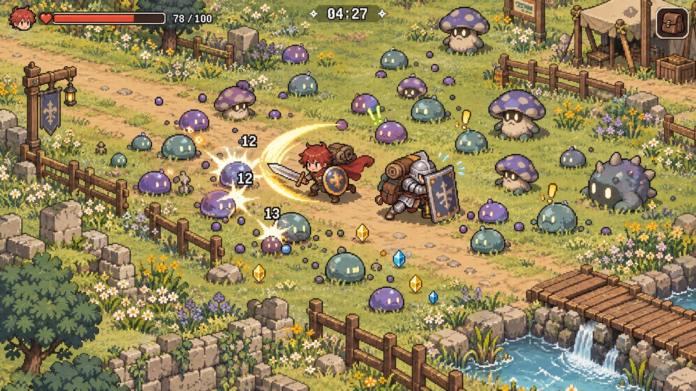
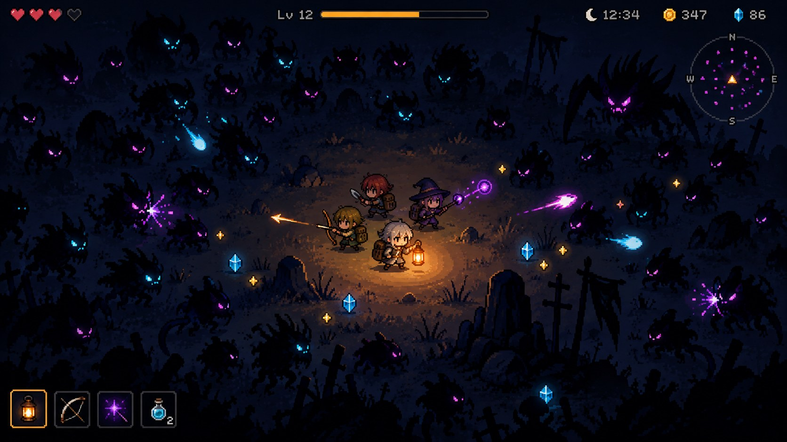
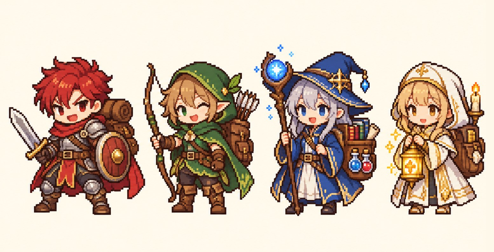
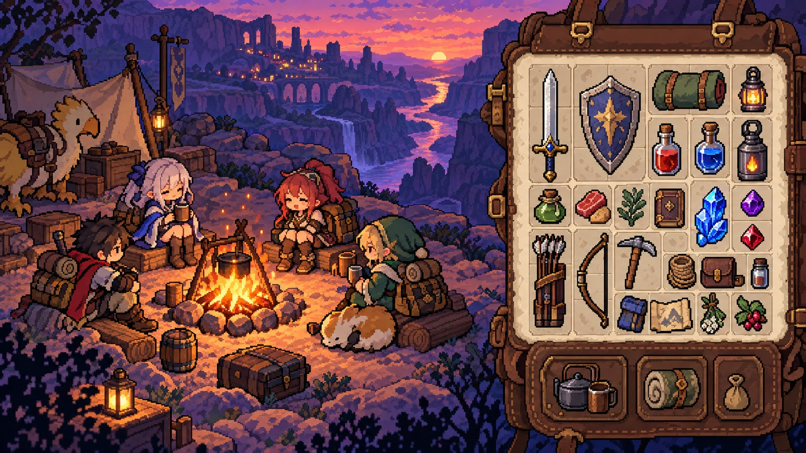

# 2D 전환 계획: 게임 스펙(2026-11-12) 대조와 할 일

- 작성: 2026-11-15, Claude(메인). 상태: **6절 결정 받음**(6.1, 2026-11-15). 4명·아이소메트릭으로 바뀐 부분은 6.2. 위 1~5절 본문은 결정 전에 쓴 것이라 "6명"·"3/4 내려다보기 추천" 같은 문장이 남아 있다. 6.1이 우선한다
- 원본: [배낭원정대_게임스펙_20261112.docx](../specs/배낭원정대_게임스펙_20261112.docx)(사용자가 준 파일을 그대로 보관, sha256 `82d0c34d…0ad9`). 컨셉 이미지 4장은 [concept-20261112/](concept-20261112/)에 뽑아 두었다.
- 비교 기준: 이전 판 [현재게임사양_20261029.docx](../specs/배낭원정대_현재게임사양_20261029.docx), 예전 게임 코드 `Assets/DeadSurvivor/Runtime/`, 데이터 `Assets/DeadSurvivor/Resources/DeadSurvivor/PrototypeData.json`
- 이 문서는 다음 단계(`/game-direction` → `/game-spec`이 쓰는 `docs/game/gdd.md`)의 입력 메모다. 기획서를 대신하지 않는다.

## 1. 요약

1. **새 스펙이 달라진 점**: 10-29판에서 수치표를 빼고("세부 수치는 별도 관리") 다음을 더했다.
   - 몰입 설계: 피드백, 실패 원인, 몬스터 HP 표시, 쿼터뷰, 가려짐
   - 피격 연출: 빨간 구간, 햅틱, 카메라 흔들림
   - 패배 원인 결과 화면
   - 편성: 4명 고정, 이전 원정대 다시 쓰기, 튜토리얼 2→4명
   - 그래픽 컨셉: 쿼터뷰 2D 도트 + SD 캐릭터 + 시간대 조명
   - 제외 목록 추가: 보스, 소모품, 서버 저장
2. **예전 게임에 이미 있는 것**: 핵심 루프(로비 → 10웨이브 → 정비 → 결과), 4×4 가방(회전·합성), 아이템 32종, 캐릭터 6명, 몬스터 5종, 진형, 버닝 타임, 전리품 가중치. 다만 새 2D 코드(`Assets/Game`)는 아직 0줄이라 **2D에서는 전부 새로 옮겨야 한다.**
3. **예전 게임에도 없는 것**:
   - 4명 고정 편성과 원정대 저장
   - 튜토리얼
   - 패배 원인 화면(가한 피해·받은 피해·사망 순서)
   - 피격 연출(빨간 구간·햅틱·흔들림)
   - 몬스터 HP 표시 규칙
   - 종료 보상·캐릭터 성장
4. **그래픽**: 컨셉 이미지는 방향이 분명하다(따뜻한 도트, 큰 배낭을 멘 SD 캐릭터, 밤에는 등불만 빛남). 만들기 전에 정할 것은 셋이다.
   - 시점 방식
   - 캐릭터 도트 크기
   - 2D 렌더 전환: 지금 프로젝트는 3D용 렌더 설정이다.
   - 키트의 도트 정리 경로는 20~32px 작은 스프라이트에서만 검증됐다. 컨셉의 하이비트(약 36~48px)는 시범이 먼저다.
5. **추천 순서**:
   - ① 그림체 시범과 게임 기획서 승인을 함께 진행
   - ② 임시 그림으로 한 판이 도는 상태
   - ③ 그림 교체
   - ④ 새 스펙에만 있는 기능
   - 튜토리얼·성장과 컨셉의 이야기 요소는 나중이다.

## 2. 새 스펙에서 바뀐 것 (10-29판 대비)

| 구분 | 10-29판 | 11-12판 (새) |
|---|---|---|
| 편성 | 1~4명, 1명 이상이면 시작 | **4명 모두 편성해야 시작**, 이전 원정대 그대로 쓰기 가능, 튜토리얼은 2명 → 4명(시점·방식 미정) |
| 핵심 재미 | 배치, 병렬 전투, 웨이브 성장 | + "수많은 몬스터를 쓸어 담는 시각적 쾌감" |
| 인게임 흐름 | 시스템 설명 중심 | 3.1절 새로 씀: 목표·피드백·난이도·실패와 재도전, 실패 원인과 다음 행동의 연결 |
| 몬스터 HP | (명시 없음) | **강한 적이나 지금 공격 중인 적만** 표시 |
| 시각 | (명시 없음) | 쿼터뷰, 캐릭터별 외형·공격 동작, 전투 가독성, 배경·조명 변화, **가려짐 처리** |
| 패배 결과 | 클리어 웨이브 등 | **캐릭터별 누적 가한 피해, 받은 피해, 사망 순서** |
| 피격 | (명시 없음) | 체력 UI 감소 구간 **빨간 강조, 짧은 햅틱, 약한 카메라 흔들림** |
| 수치 | 웨이브·캐릭터·아이템·몬스터 수치표 | 수치표 삭제("별도 관리"). 칸 모양·발동 방식만 남음 |
| 컨셉 | 동료 5명의 소원표, 야영 대사, 필드 드롭 | 소원표·야영·필드 드롭 삭제, 동료 구출은 "튜토리얼까지만" |
| 그래픽 컨셉 | 같은 이미지 4장 | 같은 이미지 4장 + 그래픽 컨셉 절(쿼터뷰 2D 도트 하이비트, 레퍼런스 7개) |
| 제외 | 유료, 동료 구출·관계, 마을, 멀티 스테이지, 최종 아트 | + **보스전, 전투 중 소모품 드랍, 결과 서버 저장·콘텐츠 개방** |

## 3. 구현 상태 대조

- "예전 게임"은 `Assets/DeadSurvivor` 코드 기준이다(3D 판, 그 전 2D 판도 같은 코드).
- 새 2D(`Assets/Game`)는 모든 항목이 **안 됨**이라 열을 따로 두지 않았다.
- **됨**은 코드에 있다는 뜻이다. 새 스펙과 숫자가 같은지는 수치표가 빠져서 대조하지 않았다.

### 3.1 아웃게임

| 스펙 항목 | 예전 게임 | 근거·비고 |
|---|---|---|
| 캐릭터 카드(이름·능력치·시작 아이템), 선택·해제 | 됨 | `DSUI.cs:206` |
| 4명 모두 편성해야 시작 | **다름** | 예전은 1명 이상이면 출전(`DSUI.cs:212` `Selected.Count > 0`) |
| 이전 원정대 그대로 쓰기 | 일부 | 한 번 켠 동안의 재편성·재출전은 있음(044). 앱을 다시 켜도 남는 저장은 없음(저장 코드 없음) |
| 튜토리얼 2명 → 4명 | 안 됨 | 스펙도 시점·방식 미정 |

### 3.2 인게임 흐름·전투

| 스펙 항목 | 예전 게임 | 근거·비고 |
|---|---|---|
| 10웨이브, 시간 종료, 조기 종료 없음, 종료 시 정리, 전멸 즉시 패배, 동시 발생은 패배 | 됨 | 10-29판 규칙 그대로. 당시 규칙 검사 695회 PASS |
| 결과 확인 뒤 로비 복귀 | 됨 | |
| 결과 화면 | 일부 | 클리어 웨이브·처치 수·전투 시간만(`DSUI.cs:397`) |
| 패배 원인: 캐릭터별 가한 피해·받은 피해·사망 순서 | **안 됨** | 받은 피해만 내부에 기록(`DSData.cs:56` `damageTaken`). 가한 피해·사망 순서는 기록 자체가 없음 |
| 몬스터 HP는 강한 적·공격 중인 적만 | **다름** | 예전은 다친 적 모두 표시(`DSWorld.cs:190`) |
| 캐릭터 머리 위 HP 바 | 됨 | `DSWorld.cs:206`, `DSWorld.Map.cs:95` |
| 상단: 웨이브·처치·위협·남은 시간·배속·일시정지 | 됨 | `DSUI.cs:414-416` |
| 하단: 캐릭터별 HP·능력치, 장착 아이템 4열 최대 16개, 쿨타임·상태, 발동 강조, 이동 입력 안 막음 | 됨 | 하단 전체 아이템 목록(할일.md "최근 변경") |
| 피격: 감소 구간 빨간 강조, 햅틱, 카메라 흔들림 | **안 됨** | 맞을 때 깜빡임만(`DSGame.Combat.cs:21`). 햅틱·흔들림 코드 0건 |
| 쿼터뷰 시점, 가려짐 처리 | 3D로 됨 | 카메라 55°와 가림 처리(`DSMapVisibility.cs`). 2D에서는 방식이 달라 새로 만든다 |
| 이동: 터치 조이스틱·WASD, 손 떼면 정지, 진형 자리 따라가기, 사망자 자리 유지 | 됨 | |
| 진형 3종(균형·쐐기·횡대), 정비에서 선택해 다음 웨이브 적용 | 됨 | |
| 아이템별 독립 쿨타임, 가장 가까운 적, 회복 대상 규칙, 정비·일시정지 중 정지 | 됨 | |
| 버닝 타임(6~10웨이브 중간부터 10초, 반대 두 방향) | 됨 | `DSGame.Run.cs:79-81` |
| 전리품 1~9웨이브 3~5개, 초반 강화·후반 합성 가중치 | 됨 | `DSGame.Run.cs:131-134` |
| 정비: 분배·배치·합성·무료 부활·진형, 시간 제한 없음 | 됨 | |

### 3.3 인벤토리·아이템·캐릭터·몬스터

| 스펙 항목 | 예전 게임 | 근거·비고 |
|---|---|---|
| 4×4 가방, 모양별 칸, 90° 회전, 밖·겹침 거부와 원상 유지 | 됨 | |
| 드래그는 놓을 때, 탭은 미리보기 → 확정, 미리보기는 실제 장비 안 바꿈 | 됨 | |
| 같은 종류·등급 합성, 전설은 끝 | 됨 | |
| 정비 화면: 가방·보관함·진형·설명, 장착 전 효과·인접·추천·수치 변화 | 됨 | |
| 아이템 32종(발동 8 + 장착 효과 24), 직업 제한 없음, 인접(대각선 제외), 상한 80%·+100% | 됨 | 수치는 `PrototypeData.json` |
| 피해·회복·주기 계산식, 방어 → 보호막 순서 | 됨 | |
| 캐릭터 6명과 시작 아이템, 공격 배수는 회복에 안 씀 | 됨 | |
| 사망 시 발동 정지·장비 잠금, 무료 부활 시 쿨타임 초기화 | 됨 | |
| 지속 회복 3초, 공유 회복(가장 큰 제공자 1명), 보호막 한도 보충 | 됨 | |
| 몬스터 5종(일반·사격·돌진·중장갑·자폭), 화면 밖 생성, 멀어진 적 재배치 | 됨 | 3D 판 외형은 046 |

### 3.4 추가 기획과 컨셉 (스펙이 프로토타입 밖으로 둔 것 포함)

| 항목 | 상태 | 비고 |
|---|---|---|
| 6장 종료 보상(경험치·골드)·기본 능력치 4종·레벨업·골드 강화 | 안 됨 | 기획만 있음([종료보상과-캐릭터성장](../design/종료보상과-캐릭터성장.md)). 지급량·곡선·비용 미정 |
| 주인공 직업 4종(전사·궁수·마법사·사제) | 안 됨 | 컨셉 문서에만 있다. 프로토타입 스펙은 캐릭터 6명이다. **6절 결정 1** |
| 동료 구출·소원·스킬 진화·야영 대화 | 제외 | 스펙 5장 |
| 지역 진행(민들레 마을 → 소원의 샘)·마을 확장 | 제외 | 스펙 5장. 단 "장마다 어두워지는 조명"은 그래픽 컨셉에 남아 있음 |
| 등불 시야·연료 기믹 | 제외 | 스펙 5장. 등불 **조명 연출**은 그래픽 컨셉(이미지 2)에 있음 |
| 멀티 스테이지·보스·소모품·서버 저장·유료/광고 | 제외 | 스펙 5장 |

## 4. 그래픽 컨셉 확인

스펙 원문: "쿼터뷰 2D 도트(하이비트) + 애니풍 SD 캐릭터 + 시간대 조명. 따뜻한 낮에서 해가 뜨지 않는 밤까지, 원정의 진행을 빛으로 보여 준다." "더 어두워질수록 원정대의 빛이 더 또렷해지는 화면."

### 4.1 이미지별로 보이는 것

| 이미지 | 보이는 것 |
|---|---|
|  **1. 들판 길 낮 전투** | 비스듬히 내려다보는 시점, 길·울타리·다리가 대각선. 풀밭·꽃·흙길·돌담·물. 빨간 머리 검사의 베기 궤적과 피해 숫자(12·13). 보라·청록 슬라임, 버섯 몬스터, 가시 바위 몬스터. 땅에 노랑·파랑 보석. HUD는 좌상단 초상화+HP, 상단 타이머, 우상단 가방 버튼 |
|  **2. 밤의 고원** | 화면 대부분이 어둠이고 등불 든 사제 둘레만 둥글게 밝다. 적은 검은 실루엣에 빛나는 눈(보라·청록)뿐. 마법·화살 궤적이 유일한 강조색. HUD는 하트·레벨/경험치 바·시간·골드·보석·나침반 미니맵, 하단 아이템 4칸 |
|  **3. 직업 4종** | 전사(빨강·은 갑옷·방패), 궁수(초록 후드·엘프 귀), 마법사(파랑 모자·지팡이), 사제(흰·금 로브·등불). 약 3등신(11-15 재관찰로 고침, 처음 적은 값 2.5), 큰 머리와 눈, 진한 갈색 외곽선. **모두 큰 배낭을 멨다**(게임 제목과 연결되는 실루엣) |
|  **4. 야영과 가방** | 노을 협곡, 모닥불, 쉬는 동료들. 오른쪽에 가죽 테두리·양피지 칸의 가방 UI와 아이템 아이콘(검·방패·물약·화살통·활 등) |

### 4.2 스펙과 어긋나는 점 (만들 때는 스펙을 따른다)

- **HUD가 다르다.** 이미지 2의 레벨·경험치·골드·보석·미니맵·소모품 4칸은 스펙에 없다. 스펙 HUD는 다음과 같다.
  - 상단: 웨이브·처치·위협·시간·배속
  - 하단: 캐릭터별 장착 아이템 16개
  - 이미지는 분위기 참고로만 쓴다.
- **보석 드롭.** 이미지 1·2에는 경험치 보석이 떨어진다. 스펙 전리품은 웨이브가 끝날 때 지급한다. 보석을 넣으려면 기획 결정이 필요하다(지금은 넣지 않는다).
- **가방.** 이미지 4는 큰 가방 하나(약 6×5칸)다. 스펙은 캐릭터마다 4×4다. UI 질감(가죽 테두리, 양피지 칸)만 가져온다.
- **몬스터 외형 대응**이 정해지지 않았다. 이미지 1의 슬라임·버섯·가시 바위를 스펙 5종에 맞춰야 한다. 제안은 일반=슬라임, 사격=버섯(포자 발사), 중장갑=가시 바위이고, 돌진·자폭은 새로 만든다.
- **이미지 4의 노란 새 탈것**은 유명 게임의 캐릭터와 비슷해 보인다. 스펙의 레퍼런스 원칙("캐릭터나 에셋은 가져오지 않는다")대로 만들지 않는다.

### 4.3 만들기 전에 정할 기술 사항

| 사항 | 지금 상태 | 제안 |
|---|---|---|
| 시점 방식 | 스펙은 "쿼터뷰". 이미지 1은 길이 대각선, 캐릭터는 3/4 정면 | **3/4 내려다보기 + 대각선은 장식 배치**를 추천한다. 아이소메트릭 격자보다 타일 이음·충돌·앞뒤 정렬이 단순하다. 시안 두 장으로 비교해 정한다 |
| 캐릭터 도트 크기 | 컨셉 캐릭터는 화면 높이의 약 13% | 가상 해상도 640×360이면 약 48px, 480×270이면 약 36px. 수백 마리 가독성과 제작량을 같이 봐서 **36px와 48px 시안을 게임 크기로 나란히** 보고 정한다 |
| 도트 제작 경로 | 키트의 도트 정리(`pixelize.py`)는 20~32px에서 검증 | 하이비트 크기는 시범 1장으로 격자·팔레트 판정이 통과하는지 먼저 본다 |
| 2D 조명 | URP가 3D 렌더러(`Assets/Settings/Mobile_Renderer`) | **URP 2D 렌더러 + Light2D**로 바꾼다. 전역 빛 색으로 장마다 시간대, 등불은 원형 Light2D. 모바일에서 조명 수 예산을 정한다 |
| 화소 정렬 | 없음 | Pixel Perfect Camera(가상 해상도 고정, 정수 배율) |
| 물량 | 예전 3D 판은 적 160마리 생성 실패 0 | 스프라이트 풀링(`PoolManager`)과 같은 아틀라스로 그리기 호출을 묶는다 |
| 애니메이션 | 없음 | SD 캐릭터 6명 × (대기·걷기·공격·피격·사망) × 방향(좌우 반전 + 위/아래). 가장 큰 제작 비용이다. 키트 규칙대로 도트는 정수 이동으로만 옮기고 프레임 판정을 거친다 |
| 레퍼런스 | 스펙 표 7개(20MTD: Emberpath, 20 Minutes Till Dawn, Hyper Light Drifter, Tiny Rogues, HoloCure, Children of Morta, Disfigure) | `/art-reference`에서 색·선·빛 쓰는 방식만 관찰한다. 캐릭터·에셋은 가져오지 않는다 |

## 5. 우리가 할 일 (순서)

| 단계 | 할 일 | 결과물 | 맡는 쪽 |
|---|---|---|---|
| 0 | 이 문서 확인, 6절 결정 | 결정 기록 | 사용자 |
| 1 | **그림체 시범**: 컨셉 이미지와 레퍼런스 관찰(`/art-reference`) → 아트 기준서(`/art-spec`: 시점, 도트 크기, 팔레트, 외곽선, 조명 단계) → 들판 한 화면 시범(캐릭터 2·몬스터 2·타일·낮/밤) | `docs/art/아트-기준서.md`, 시범 화면 | 에이전트, 승인은 사용자 |
| 1' | **게임 기획서**(1과 동시에): 이 스펙 + 예전 수치(`PrototypeData.json`)로 `/game-direction` → `/game-spec`. 첫 판 범위를 자르고 승인 1회 | `docs/game/direction.md`, `docs/game/gdd.md` | 에이전트, 승인은 사용자 |
| 2 | **뼈대**: Core(LifetimeScope·EventBus·PoolManager·GameLogger), 2D 렌더러·Pixel Perfect Camera, 장면 흐름(로비 → 전투 → 정비 → 결과) | `Assets/Game` 기반 코드 | 에이전트 |
| 3 | **시스템 옮기기**(임시 그림): 아이템 데이터 32종 → 가방 배치·회전·합성 → 계산식 → 웨이브·전리품·버닝 → 이동·진형·자동 발동 → 몬스터 5종 → HUD·하단 목록·정비·결과. 순수 로직은 에디터 테스트로 확인 | 한 판이 도는 2D 판 | 에이전트 |
| 4 | **한 판 판정**: 로비 → 10웨이브 → 결과가 끝까지 도는지 Play 판정 경로로 확인 → 사용자 플레이 | 판정 기록, 사용자 의견 | 에이전트 + 사용자 |
| 5 | **그림 교체**(`/2d-art-produce`): 캐릭터 6, 몬스터 5, 타일·장식, 아이콘 32, 효과(베기·투사체·폭발·번개·회복), 낮·밤 조명 | 게임에 들어간 그림 | 에이전트, 채택은 사용자 |
| 6 | **새 스펙에만 있는 기능**: 4명 고정 편성 + 원정대 저장, 패배 원인 결과 화면, 피격 연출(빨간 구간·햅틱·흔들림), 몬스터 HP 표시 규칙, 2D 가려짐 처리 | 기능 | 에이전트 |
| 나중 | 튜토리얼(2 → 4명, 방식 미정), 종료 보상·캐릭터 성장(수치 미정), 컨셉 이야기 요소(스펙 5장 제외 목록) | — | 사용자 결정 뒤 |

- 6단계 기능은 4단계(한 판) 뒤로 미루는 것을 추천한다. 첫 판 기획서(1')에서 "첫 판에 넣을지"를 따로 정할 수 있다.
- 예전 3D 코드·장면·문서는 읽기만 한다(루트 `CLAUDE.md` "지금 방향").

## 6. 사용자가 정할 것

| # | 질문 | 추천 | 이유 |
|---|---|---|---|
| 1 | 캐릭터: 스펙의 6명(브루노·한스·레나·유키·볼트·미라)을 유지할까, 컨셉의 주인공 직업 4종으로 바꿀까? | **6명 유지, 외형을 직업으로 구분**(전사형 브루노·한스, 궁수형 레나·유키, 마법사형 미라, 사제형 볼트) | 프로토타입 스펙·데이터·시작 아이템이 6명 기준이다. 컨셉 이미지 3의 직업 외형은 그대로 쓸 수 있다 |
| 2 | 시점: 3/4 내려다보기와 아이소메트릭 격자 중 무엇으로? | **3/4 내려다보기**(시안 비교 뒤 확정) | 타일·충돌·정렬이 단순하다. 대각선 느낌은 배치로 낸다 |
| 3 | 캐릭터 도트 크기 | 36px·48px 시안을 게임 크기로 보고 결정 | 가독성과 제작량이 이 숫자에 달려 있다 |
| 4 | 첫 판에 새 스펙 기능을 넣을까? | **4명 고정 편성·피격 연출·몬스터 HP 규칙은 첫 판에, 패배 원인 화면·원정대 저장은 첫 판 직후, 튜토리얼·성장은 나중** | 앞의 셋은 작고 전투 느낌에 바로 보인다 |
| 5 | 수치: 스펙에서 빠진 수치를 예전 값(10-29판, `PrototypeData.json`)으로 시작할까? | **예** | 695회 규칙 검사와 자동 비교를 거친 값이다. 밸런스는 사람 플레이 뒤 조정한다 |
| 6 | 그림 만드는 도구와 비용 | 이미지 생성(Codex 등)과 키트 도트 정리 도구. 유료 생성(Aether 동작 프레임 등)은 쓰기 전에 따로 묻는다 | 크레딧이 드는 일은 승인 뒤에 한다 |

### 6.1 사용자 결정 (2026-11-15)

원문: "1번 우선 4명, 2 아이소매트리, 2 보고 결정하자 4 너말대로 5 예 6 codex를 활용해"(세 번째 "2"는 3번 질문의 답으로 읽었다).

| # | 결정 | 따라오는 것 |
|---|---|---|
| 1 | **캐릭터는 우선 4명**(컨셉의 직업 4종: 전사·궁수·마법사·사제) | 아래 6.2 |
| 2 | **시점은 아이소메트릭** | 아래 6.2 |
| 3 | **도트 크기는 시안을 보고 결정** | 1단계 그림체 시범에서 36px·48px(필요하면 그 사이) 시안을 게임 크기로 나란히 보인다 |
| 4 | **첫 판 범위는 추천대로**: 4명 고정 편성·피격 연출·몬스터 HP 규칙은 첫 판, 패배 원인 화면·원정대 저장은 첫 판 직후, 튜토리얼·성장은 나중 | |
| 5 | **수치는 예전 값으로 시작**(10-29판, `PrototypeData.json`) | 캐릭터 수가 줄어든 만큼은 기획서에서 조정 |
| 6 | **그림은 Codex로 만든다** | `.ai/rules/art-tools.md`의 Codex 이미지 생성 절차(입력 닫기·시간 상한 20분·주기 확인). 검토는 다른 모델 계열(Claude)이 한다 |

### 6.2 결정에서 따라오는 것 (다음 단계에서 확인)

- **4명 구성 제안**(기획서 승인 때 확인):
  - 전사 = 브루노(장검), 궁수 = 레나(단궁), 마법사 = 미라(화염 지팡이), 사제 = 볼트(치유 성물)
  - 한스(전투 도끼)·유키(쇠뇌)는 빠지고, 두 시작 아이템은 전리품으로만 남는다.
  - 이름을 컨셉 이미지 외형에 맞춰 바꿀지는 미정이다.
- **편성 화면이 단순해진다**: 캐릭터가 4명이고 4명 모두 편성해야 하므로, 로비는 "고르기"가 아니라 "원정대 확인·출발"이 된다. 캐릭터가 늘면 다시 고르기가 생긴다.
- **아이소메트릭이 바꾸는 것**:
  - 바닥은 2:1 마름모 타일. Unity Isometric Tilemap을 쓰고, 앞뒤 정렬은 화면 Y 기준(Transparency Sort Axis)으로 한다.
  - 조이스틱 방향을 화면 기준으로 둘지 격자 기준으로 둘지 정한다(추천: 화면 기준, 위로 밀면 화면 위로).
  - 진형 3종의 "고정 방향"을 아이소 화면에서 어느 쪽으로 둘지 정한다.
  - 충돌은 바닥 평면 좌표로 계산하고 그릴 때만 아이소로 바꾼다(예전 전투 계산을 그대로 옮기기 쉽다).
- **아이소 타일 위험**: 키트의 타일 이음 검사(`tileprev.py`)는 사각 타일 기준이다. 마름모 타일의 이음 판정은 시범에서 따로 확인해야 한다. 가능하면 바닥은 큰 덩어리 그림과 적은 수의 마름모 타일로 시작한다.

## 7. 확인한 방법

- 문서: 사용자 파일을 작업 폴더 밖 임시 폴더로 복사해 본문·표·그림을 뽑았다(이미지 4장). 10-29판도 같은 방식으로 뽑아 줄 단위로 비교했다.
- 코드: `Assets/DeadSurvivor/Runtime/`에서 항목별 키워드를 찾고, 위 표의 줄 번호를 직접 확인했다. 실행해서 확인한 것은 아니다. "됨"은 코드에 있다는 뜻이며, 이번에 Play로 다시 확인하지 않았다.
- 컨셉 이미지는 메인이 직접 보고 적었다. 픽셀 크기(36~48px)는 이미지 속 캐릭터 높이로 어림한 값이다.
